# 全球变暖背景下 PDO 与东亚夏季降水关系的模拟及未来变化

## ——从 MIROC6 多成员分析到 ACCESS-CM2 与西太平洋副热带高压诊断

**大学生创新研究项目报告｜2026 年 11 月 23 日**

配套材料：[完整图像附录](Report_figure_appendix_2026-11-23.md)｜[数据批次与图像来源](Report_data_provenance_2026-11-23.md)。正文与附录共保留 69 张研究结果图，另附 1 张文献方法参考图，供最终选图。本文依据指定任务文档、两份 MIROC6 notebook、论文及开题材料、仓库代码和已保存结果重写；本次完成了来源核对及关键数值复核，并未从全部原始资料重新运行所有气候分析。

## 摘要

太平洋年代际振荡（Pacific Decadal Oscillation，PDO）与东亚夏季降水的统计关系能否在未来增暖背景下保持稳定，是理解区域水文气候变化的重要问题。本研究首先按照 Task 1—4 的顺序，利用 ERSSTv4、GPCC 月资料和 MIROC6 模式建立北太平洋海温经验正交函数（EOF）、PDO 位相分类及夏季降水合成分析流程，继而使用 ACCESS-CM2 检验成员差异和未来变化，并通过功率谱、500 hPa 位势高度和 850 hPa 流函数 EOF 扩展诊断。历史时段为 1900—2014 年，未来时段为 2015—2100 年。MIROC6 历史分析包含 10 个成员，实际保存的未来图包含 r3、r4、r6 在四个 SSP 情景下的结果；ACCESS-CM2 海温和降水分析包含五个成员及 SSP245、SSP585 两个情景。

结果表明，模式对 PDO 海温空间型的再现并不保证对其降水联系具有同等技巧。ACCESS-CM2 历史 PDO 型与观测的面积加权空间相关为 0.205—0.844，而相应降水合成差与观测的未加权空间相关仅为 −0.228—0.204。未来降水合成差在成员之间呈现明显分歧，现有样本不能支持其随排放情景一致增强或减弱的结论。功率谱揭示不同成员的主谱峰及峰带方差存在差异，但记录长度、频带选择和标准化限制了对 PDO 绝对强度变化的判断。副高诊断显示，固定 5870 gpm 阈值容易混入模式平均态偏差和未来高度场整体抬升；等面积阈值改善了轮廓比较，但 PDO 正负位相下的西伸差异仍缺乏成员一致性。另一方面，ACCESS-CM2 三成员、两情景的流函数副高指数在未来的标准差均有所增加，增幅为 2.4%—27.3%，强事件发生率也均上升。这是本项目样本内方向较一致的结果，但尚不构成 PDO 导致副高或降水变化的因果证据。研究说明，需要同时考察海温模态可比性、内部变率及环流指标定义，才能合理评价未来 PDO—降水关系的稳健性。

**关键词：**太平洋年代际振荡；东亚夏季降水；内部变率；西太平洋副热带高压；CMIP6；MIROC6；ACCESS-CM2

## 1　研究背景与目标

东亚夏季降水受到海温异常、大尺度环流及区域水汽输送的共同影响。PDO 是北太平洋海温变化的重要统计表征，其低频变化与东亚夏季风和中国东部降水分布存在联系。Yu（2013）讨论了 PDO 与东亚夏季风年代际变化的对应关系；Dong（2016）进一步在非 ENSO 年条件下分析其季节内差异及副热带高压配置。这些研究为本项目从海温空间型、位相时间序列到降水合成的设计提供了依据，但不意味着任何资料和时段都必然产生相同的“南涝北旱”分布。[Yu，2013](https://doi.org/10.3878/j.issn.1674-2834.13.0040)；[Dong，2016](https://doi.org/10.1002/asl.634)。

PDO 也不应被视为具有唯一固定周期、独立驱动全部区域气候变化的单一振子。Newman 等（2016）指出，PDO 涉及多个过程的共同作用；多海盆信号和东亚—太平洋遥相关也会影响降水，因此识别统计联系需要考虑其他海温和环流因素。[Newman 等，2016](https://doi.org/10.1175/JCLI-D-15-0508.1)；[Zhang 等，2018](https://doi.org/10.1175/JCLI-D-17-0657.1)；[Li 等，2018](https://doi.org/10.1175/WAF-D-17-0011.1)。开题 Review 中涉及的未来极端 El Niño 降水响应研究进一步提示 ENSO 是不能忽略的背景因素；暖时段模拟研究则直接提出 PDO—中国东部降水联系可能不稳定。[Veiga 与 Yuan，2022](https://doi.org/10.1016/j.atmosres.2021.105983)；[Wu 与 Jiang，2024](https://doi.org/10.1016/j.gloplacha.2024.104458)。

全球变暖使背景海温、大气热力状态及环流条件发生变化，从而可能改变上述统计关系。Reichle（2023）的气候模式章节和 Liu 等（2024）的气候变化概述提供了模式、情景及不同时间尺度变率的基础；Lehner 与 Deser（2023）强调内部变率的重要性与可预测性限制。因此，同一模式的不同初始条件成员出现差异本身就是需要解释的结果，不能仅通过选择一张最符合预期的图得到结论。[Reichle，2023](https://doi.org/10.1016/B978-0-443-18775-9.00010-3)；[Liu 等，2024](https://doi.org/10.1016/B978-0-323-90430-8.00010-1)；[Lehner 与 Deser，2023](https://doi.org/10.1088/2752-5295/accf30)。

本项目依次回答四个问题：第一，MIROC6 和 ACCESS-CM2 能否再现 PDO 海温空间型及相应降水分布；第二，成员差异是否掩盖了未来情景下的一致变化；第三，功率谱能否帮助理解 PDO 位相的时间尺度；第四，西太平洋副热带高压（WPSH）的位置与年际变率能否提供进一步的环流解释。本文以中国东部及周边区域夏季降水作为东亚夏季风相关水文响应，未另外计算统一的东亚夏季风强度指数。

## 2　资料、研究阶段与数据来源

### 2.1　观测参考与再分析

海温采用 ERSSTv4 月资料 `sst.mnmean.v4.nc`，降水采用 GPCC Full Data Monthly v2018、0.5° 月降水总量资料 `precip.mon.total.v2018.nc`。二者取 1900—2014 年作为历史比较窗口。ERSSTv4 为重建海温产品，GPCC 为雨量站资料构建的陆地格点产品，因此本文的“观测”指这些格点参考资料，而不是每个格点均有直接连续观测。[Huang 等，2015](https://doi.org/10.1175/JCLI-D-14-00006.1)；[GPCC v2018 产品说明](https://opendata.dwd.de/climate_environment/GPCC/html/fulldata-monthly_v2018_doi_download.html)。

Task 6 使用 NCEP/NCAR Reanalysis 1 的 500 hPa 月平均位势高度，参考时段为 1948—2014 年。PDO 分类与此时段相交后有 27 个正位相、36 个负位相夏季。Task 7 使用 ERA5 全球 0.25° 和 NCEP/NCAR 全球 2.5° 的 850 hPa 月风，均分析 1979—2020 年的 42 个夏季。[Hersbach 等，2020](https://doi.org/10.1002/qj.3803)；[NCEP/NCAR 数据说明](https://psl.noaa.gov/data/gridded/data.ncep.reanalysis.html)。

### 2.2　模式、成员与情景

MIROC6 和 ACCESS-CM2 均为 CMIP6 模式，但本项目是依次使用两种模式开展探索与补充检验，尚未建立统一的多模式统计集合。模式说明及情景框架分别参考 Tatebe 等（2019）、Bi 等（2020）、Eyring 等（2016）和 O’Neill 等（2016）。[MIROC6](https://doi.org/10.5194/gmd-12-2727-2019)；[ACCESS-CM2](https://doi.org/10.1071/ES19040)；[CMIP6](https://doi.org/10.5194/gmd-9-1937-2016)；[ScenarioMIP](https://doi.org/10.5194/gmd-9-3461-2016)。

|研究阶段|实际采用的成员|试验与分析时段|主要资料|
|---|---|---|---|
|MIROC6 Task 1—2 基础流程|r10i1p1f1|historical，1900—2014|tos、pr；与 ERSSTv4/GPCC 对照|
|MIROC6 Task 3 历史集合|r1—r10，均为 i1p1f1|historical，1900—2014|海温 EOF、PC1、降水合成及成员方差|
|MIROC6 Task 4 未来比较|实际图中为 r3、r4、r6|SSP126、SSP245、SSP370、SSP585，2015—2100|每个情景三成员|
|ACCESS-CM2 Task 1—4|r1—r5，均为 i1p1f1|historical 1900—2014；SSP245/585 2015—2100|tos、pr|
|ACCESS-CM2 Task 5|历史 r1—r5；未来 r2、r3、r5|同上|已保存的月度 PDO PC1|
|ACCESS-CM2 Task 6|r1、r2、r5|历史与未来窗口同上|500 hPa zg|
|ACCESS-CM2 Task 7|r1、r2、r5|每个情景拼接 1900—2100 年|全球 850 hPa ua、va|

原始说明中的“SSP270”在实际文件、代码和图中均对应 **SSP370（SSP3-7.0）**。同时，MIROC6 未来目录中存在更多成员并不代表最终图使用了全部成员；指定 notebook 的执行记录明确载入 `r3/r4/r6`。这些情景是外部强迫路径，本文没有按全球平均温升跨越 1.5°C 或 2°C 的年份取样，因此不能把 SSP245、SSP585 直接当作某个固定增温水平。

### 2.3　两批 ACCESS 下载与绘图版本的区分

本次读取移动硬盘后，可把资料分为以下来源。批次代号用于图注，不表示新的模式或独立试验。

|代号|位置与内容|对应分析及可核实程度|
|---|---|---|
|A|`ACCESS-CM2_data`：30 个 tos/pr 文件，五成员、三个试验；文件修改时间集中于 2026-08-25|Task 1—5 的海温/降水资料体系。仓库记录 SSP245 r3 的 pr 曾损坏，计算端已从 NCI v20200428 替换；本地同名文件不能仅凭文件名视为替换后的副本|
|Z-sub|`ACCESS-CM2_zg_script_20260911`：14 个只保留 500 hPa 的文件；另有早期 r1 测试目录|2026-09-12 16:14（北京时间）完成的子集下载；不是新增的气候试验|
|Z-full|硬盘根目录 14 个原始全层 zg 文件，下载任务记录在 `download_job_20260912`|2026-09-13 04:06（北京时间）完成；确定对应 `figures/task6_wpsh/` 的六张早期图|
|Z-current|仓库 `task6_wpsh.py` 读取 `data/processed/zg500_*`|现行固定阈值/等面积阈值三张图；由 Z-full 对应的已提交年度高度场可重建全部九组等面积阈值和位相西界，均与当前汇总一致到保存精度|
|W|Task 7 风场下载脚本及逐组 manifest|850 hPa 风场分析；不能从 zg 或 tos/pr 文件替代推断|

Z-sub 与 Z-full 的 14 个原始文件记录 SHA256 全部一致。本次逐文件比较 500 hPa 首、中、末三个时间片，42 个完整空间切片的数值全部相同，解码后的时间及经纬度也一致。根目录全层文件的 tracking ID 和字节数均匹配早期 Task 6 输入清单，六张早期 PNG 与硬盘同名输出逐字节一致。因此，这两次下载主要是**同源资料的不同存储形式**，不能作为两组独立结果增加证据权重。这里的校验码一致指下载清单中的原始校验码，本次未重新计算全部 18.9 GB 原始文件的整文件哈希，也未比较所有月份。更完整的路径、版本与证据见[来源附录](Report_data_provenance_2026-11-23.md)。

## 3　研究方法

### 3.1　Task 1：北太平洋 EOF 与 PDO 指数

依任务设计，截取 20°—60°N、110°—250°E 北太平洋月海温，逐格点线性去趋势并去除各月气候态，用纬度权重 √cosφ 进行 EOF 分析。第一主成分按单位方差缩放，第一模态作为本研究的 PDO 定义；统一符号，使 35°—45°N、160°—200°E 核心区在 PDO 正位相时为冷异常。图中的海温空间型采用对标准化 PC1 的回归/协方差表示，具有海温单位，不是无量纲 EOF 特征向量。EOF 实现参考 `eofs` 工具。[Dawson，2016](https://doi.org/10.5334/jors.122)。

MIROC6 使用事先插值的规则网格资料。ACCESS 的原生海洋网格 tos 通过球面近邻距离加权插值到 2° 规则网格，降水插值到 GPCC 0.5° 网格。历史和每个未来情景分别去趋势、计算气候态和 EOF。此定义未另外减去全球平均海温，也不保证未来 EOF1 与历史 EOF1 始终代表同一个物理模态；若空间型变化很大，指数间的物理可比性需另行检验。

### 3.2　Task 2：位相分类与降水合成

先对标准化月度 PC1 作 108 个月居中的滑动平均，再以各年 6—8 月（JJA）平滑指数的均值符号划分 PDO 正、负位相。历史期有 107 个可分类夏季（1904—2010），未来有 78 个（2019—2096）；首尾样本由实际滑动窗口及缺测处理决定。分类使用零阈值，并非开题方案中曾讨论的 ±1 个标准差事件筛选。未平滑的月 PC1 用于后续频谱分析。

观测月降水总量除以当月天数转成 mm/day；模式 pr 从 kg m⁻² s⁻¹ 转为相同单位。三个夏季月份等权平均，减去各自分析时段的夏季气候平均得到异常。因而结果是夏季平均降水率异常，而不是 Task 2 文档文字中“夏季累计降水总量”的单位。定义

$$
D(x)=\overline{P'(x)\mid PDO+}-\overline{P'(x)\mid PDO-}.
$$

`D` 为正表示正 PDO 位相相对负位相更湿，并不表示未来平均降水增加。降水异常本身未做线性去趋势，未来时段中不同位相的年份分布仍可能混入强迫降水趋势。ACCESS 降水分析使用 GPCC 陆地掩膜，MIROC6 旧图中仍有海域值，两套图的空间范围和统计支撑并不完全相同。

图中白点若存在，表示正负位相样本的逐格点 Welch t 检验 p<0.1。九年平滑使位相年份具有成段持续性，现有检验没有处理有效样本量或多重比较，因此白点仅作为探索性标记，不应直接解释为区域整体具有稳健显著性。

### 3.3　Task 3—4：成员差异与未来变化

历史成员分别计算海温型和降水 `D`，以成员间样本方差（分母 n−1）描述空间离散程度。降水分布按成员分别展示，保留成员间方差图；Task 3—4 不再计算或保存成员平均降水场。历史降水合成型的相关对象为观测，未来变化按同一成员与其自身历史结果比较。

Task 1 汇总中的 PDO 空间相关采用面积加权；Task 3 降水及 Task 4 空间相关为共同有效格点上的未加权 Pearson 相关。本文在表中分别注明，避免混用指标。未来变化按同一成员计算

$$
\Delta D_{s,m}(x)=D_{s,m}(x)-D_{hist,m}(x),
$$

其中 s 表示情景、m 表示成员。ACCESS 当前 T4-7 对应 SSP245 减历史，T4-8 对应 SSP585 减历史；它们不是未来减观测，也不是两个未来情景相减。MIROC6 原 T4-7 是三成员平均的 SSP585−SSP126，按本次选图要求排除。

### 3.4　Task 5：功率谱及其解释边界

借鉴 Veiga 等（2020）展示空间模态、时间系数及功率谱的组织方式，对未作九年平滑的标准化月度 PC1 计算周期图，使用五点 Daniell 平滑，并以一阶自回归 AR(1) 红噪声作为背景。代码以近似自由度 10 构造 χ² 逐频点 90% 和 95% 阈值，在 2 年至记录长度三分之一的周期范围内优先寻找超过阈值的谱峰，再积分与峰相连、超过红噪声背景的频带。红噪声谱检验的基本思想亦见 Gilman 等（1963）。[Veiga 等，2020](https://doi.org/10.3390/atmos11010003)；[Gilman 等，1963](https://doi.org/10.1175/1520-0469%281963%29020%3C0182%3AOTPSON%3E2.0.CO%3B2)。

“cycle energy”在本项目中是谱积分得到的统计方差或方差占比，不是物理能量。标准化 PC1 已去掉各序列总振幅信息，不同主峰频带也不完全相同。先寻找谱峰再报告逐频点阈值，还没有控制搜索多个频率造成的选择效应。因此本文报告的是谱形诊断，不把它作为 PDO 绝对振幅增强/减弱的正式检验。

### 3.5　Task 6：500 hPa 副高轮廓

沿用 Task 2、4 的 PDO 年份，分别合成 JJA 500 hPa 位势高度。参考 Dong（2016）的轮廓诊断，先画固定 5870 gpm 等值线；本项目保留全部 ENSO 状态，与该论文的非 ENSO 年筛选不同。CMIP6 `zg` 已是高度、单位 m，不能再除以重力加速度。

为比较平均态明显不同的场，现行分析还使用等面积阈值：先计算 NCEP 1948—2014 年气候态在 10°—40°N、110°—180°E 内高于 5870 gpm 的余弦纬度加权面积比例（0.31766），再在各成员、各试验自身气候态中选择达到相同比例的阈值 Tm。每个数据集的正负位相共用其 Tm。该方法是气候态面积匹配，不是把模式高度统一加上一个常数。

西界定义为 10°—40°N、100°—180°E 内高度达到阈值的最西格点经度；没有符合格点则记为空。它是离散格点指标，未筛选连通的副高主体，也不是等值线上精确插值的西脊点。等面积方法可帮助比较相对形态，但按定义已固定气候态包围面积，不能再用它证明副高平均面积增加。

### 3.6　Task 7：850 hPa 流函数副高指数

Yang 等（2022）以低层环流变率分析温室增暖下副高变化，为本项目提供了另一条诊断路径。[Yang 等，2022](https://doi.org/10.1073/pnas.2120335119)。本项目先在全球球面上由 850 hPa 风场求旋转分量及流函数，再在 10°—40°N、110°—180°E 区域对夏季流函数进行 √cosφ 加权 EOF；利用 15°—25°N、120°—150°E 的区域流函数约束指数方向。

ERA5/NCEP 在 1979—2020 年的 JJA 序列上去除线性趋势。ACCESS 对各情景拼接的 1900—2100 年资料逐月作二次去趋势，之后计算 JJA 和全时段 EOF，并以 1900—2014 年均值、标准差固定标准化：

$$
I(t)=\frac{PC1(t)-\overline{PC1}_{1900-2014}}{s_{1900-2014}},\qquad I>1.5\ \text{为强事件}.
$$

历史 115 年与未来 86 年长度不同，因此比较标准差比值和强事件夏季占比，同时保留次数。模式高地以下的缺测风场使用球面调和延拓，并与最近邻延拓作敏感性对照。延拓用于使全球球面运算成立，不能解释为恢复真实地下风场。每个情景独立拟合全时段 EOF，两个情景的历史指数并非完全相同，也不能把它们作为两份独立历史样本。更详细实现见[Task 7 方法](Task7_WPSH_streamfunction_EOF.md)。

## 4　MIROC6 基础分析：Task 1—4

### 4.1　Task 1—2：建立海温—位相—降水分析流程

指定 notebook 的文件读取记录显示，Task 1—2 实际使用 MIROC6 r10i1p1f1。其 PDO 第一模态解释海温方差的约 24.6%，ERSSTv4 为 20.5%。两者均表现为北太平洋中部冷异常与东部、北侧暖异常相对配置，说明该单成员能够产生与观测相似的主要海温型（图 1）。模式相位时间并不需要与真实年份逐年同步；自由运行历史试验不能按 PC 峰值是否与观测同年出现评价预测技巧。

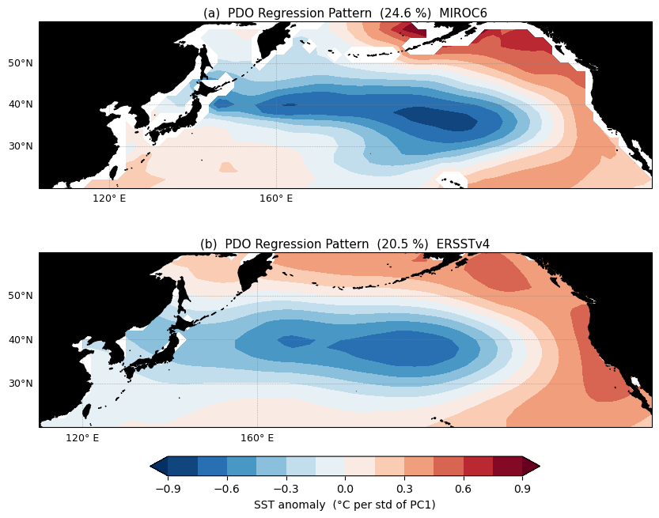

**图 1　MIROC6 单成员与 ERSSTv4 的 PDO 空间型。1900—2014 年；Task 1–2 为 r10i1p1f1。 空间型为 SST 对标准化 PC1 的回归型，不能把色标当成无量纲特征向量。 数据来源：M：MIROC6 notebook 与硬盘输出。

观测降水正减负合成差在华北—黄淮部分地区偏干，长江中下游及江南部分地区偏湿，而华南沿海又有偏干区（图 2）。因此结果更接近具有区域差异的雨带调整，而不是整个南方同号增湿。MIROC6 r10 的合成差在位置、范围和幅度上与观测存在差别，尤其在南部和近海区域；海温型相似不足以保证降水遥相关的正确再现。该阶段完成了后续集合研究所需的基本流程。

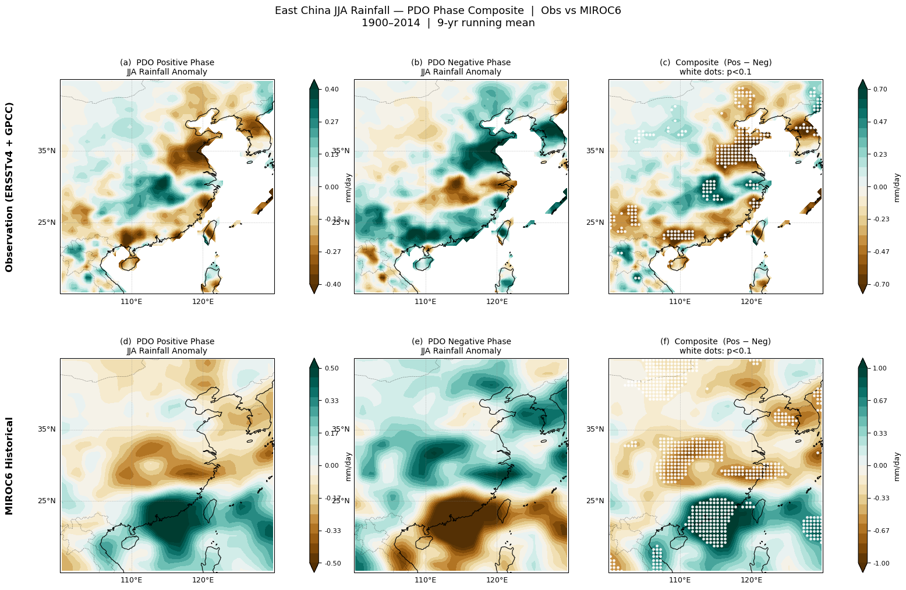

**图 2　观测与 MIROC6 r10 的降水位相对照。1900—2014 年；Task 1–2 为 r10i1p1f1。 降水单位 mm/day；MIROC6 原图保留了海域，不能与 ACCESS 陆地掩膜图直接比较面积统计。 数据来源：M：MIROC6 notebook 与硬盘输出。

### 4.2　Task 3：十成员历史离散度

将分析扩展至 r1—r10 后，EOF1 方差贡献为 24.6%—29.0%，多数成员保留相近的北太平洋大尺度结构（图 3），但冷中心位置和幅度有所不同。降水合成差的成员差异明显大于海温空间型的视觉差异（图 4）；相同区域可以在不同成员中呈现相反异常。正、负位相降水成员方差图均在南部及邻近海域显示较强离散度，具体见附录。

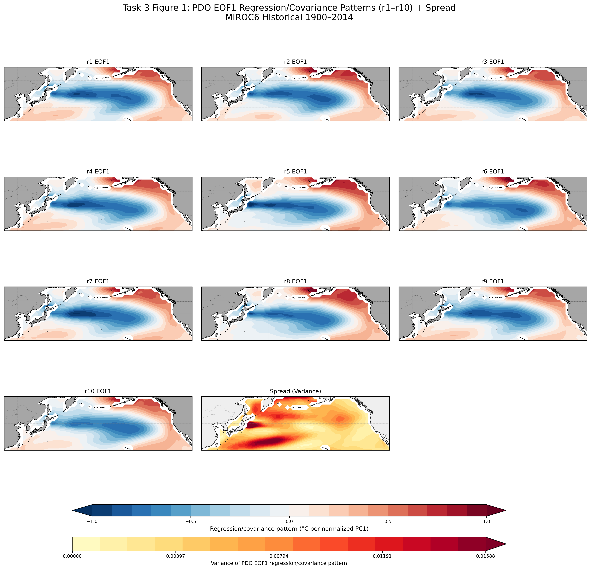

**图 3　MIROC6 十成员历史 PDO 空间型及成员方差。1900—2014 年；r1–r10。 空间型为 SST 对标准化 PC1 的回归型，不能把色标当成无量纲特征向量。Spread 是成员间样本方差，不是成员平均降水图。 数据来源：M：MIROC6 notebook 与硬盘输出。

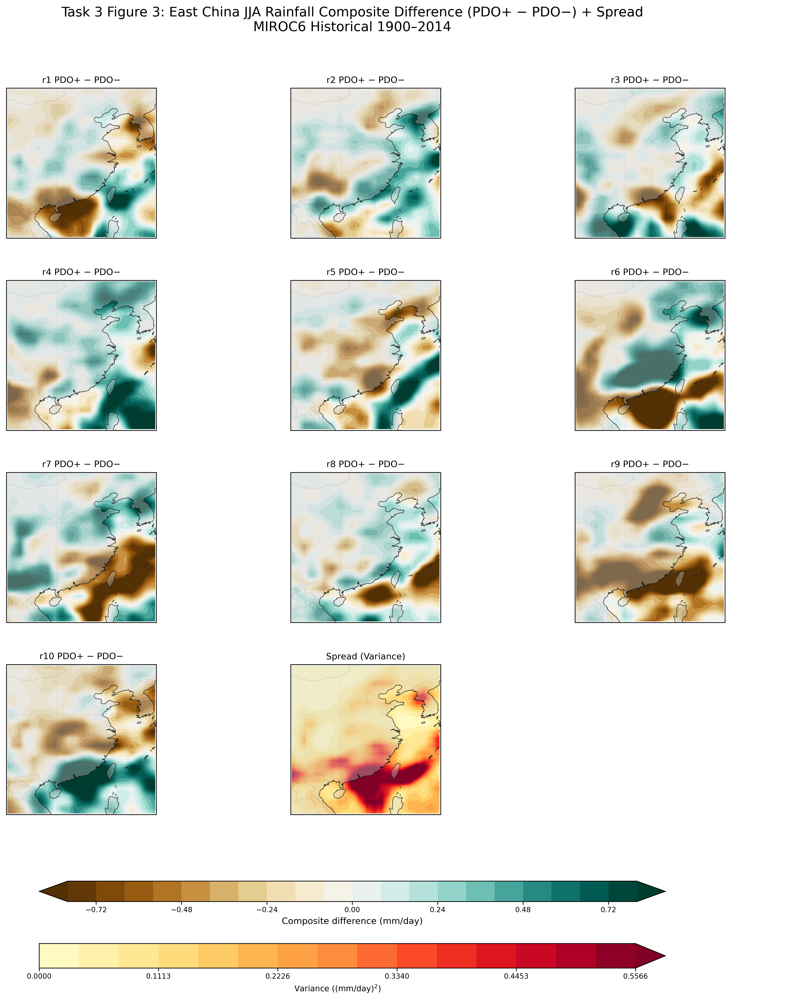

**图 4　MIROC6 十成员历史降水合成差及成员方差。1900—2014 年；r1–r10。 降水单位 mm/day；MIROC6 原图保留了海域，不能与 ACCESS 陆地掩膜图直接比较面积统计。Spread 是成员间样本方差，不是成员平均降水图。 数据来源：M：MIROC6 notebook 与硬盘输出。

这一结果说明，单成员得到的降水型不足以代表该模式的唯一响应。成员间的位相年份数也不同，例如 r1 为 44/63 个正/负夏季，r5 为 68/39，r10 为 62/45；不同位相抽样与内部变率共同影响合成结果。此处成员方差是有限样本离散度，并没有通过正式方差分解量化纯内部变率贡献。

### 4.3　Task 4：四情景的三成员结果

未来 notebook 执行记录载入的成员是 r3、r4、r6，四情景分别为 SSP126、SSP245、SSP370、SSP585。原流程含按历史降水合成差与集合平均相似性选择成员的步骤，这不等于独立的观测技巧筛选。实际选中的三成员结果应视为子集合探索，不能代表完整十成员未来分布。

未来 PDO EOF1 贡献约为 23.7%—32.8%，主要海温结构仍可辨认，但降水差异随成员和情景明显改变（图 5）。例如同一情景内的正负异常中心并不一致，同一成员也未呈现从 SSP126 至 SSP585 的简单单调演变。基于这些图，本项目没有识别出跨成员一致的 PDO 相关降水增强或减弱趋势；这促使研究增加 ACCESS-CM2 作为补充，而不是预设换用模式后必须得到确定趋势。

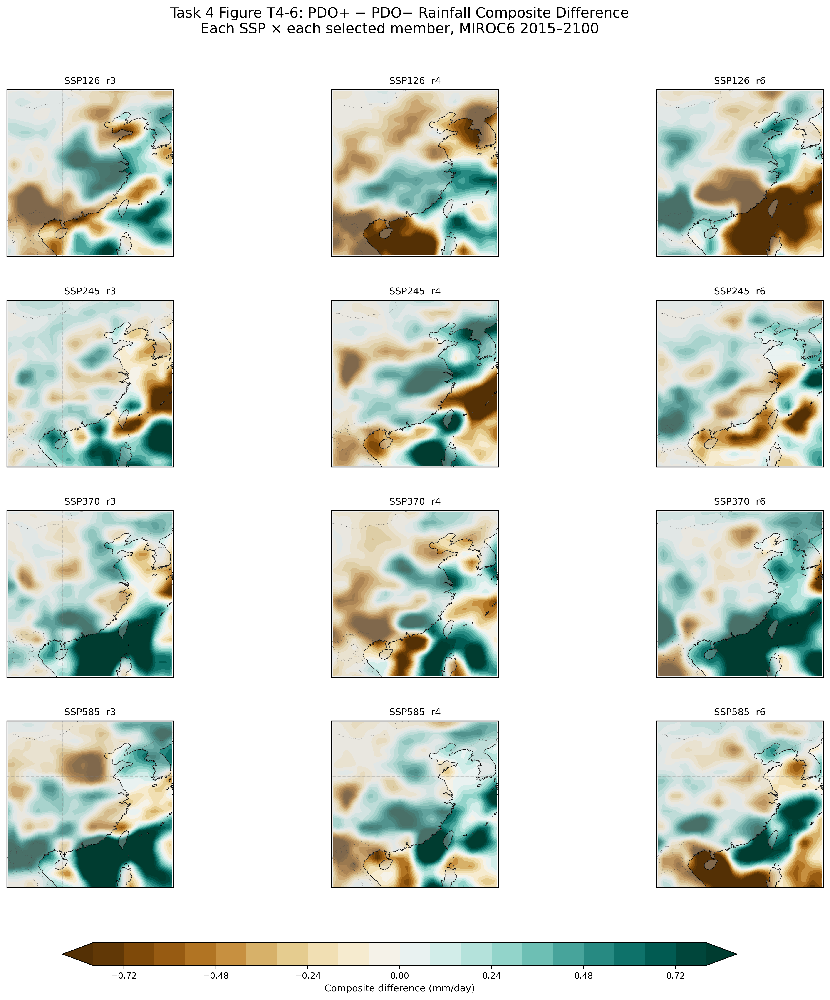

**图 5　MIROC6 四情景三成员正减负位相降水合成差。2015—2100 年；SSP126、SSP245、SSP370、SSP585；仅 r3、r4、r6。 降水单位 mm/day；MIROC6 原图保留了海域，不能与 ACCESS 陆地掩膜图直接比较面积统计。 数据来源：M：MIROC6 notebook 与硬盘输出。

## 5　ACCESS-CM2 补充分析：历史技巧与未来差异

### 5.1　Task 1—3：PDO 型与降水型的技巧不同

ACCESS 历史五成员 PDO 型与观测的相似程度差异很大。r1、r2、r3、r5 的面积加权空间相关为 0.760—0.844，r4 仅为 0.205（图 6）。r4 的首模态在黑潮延伸附近表现出更强的局地结构，提示“固定取 EOF1”可能在个别成员中纳入与典型 PDO 不同的主导变化。本文保留既定 EOF1 规则，没有根据与观测相关高低事后切换模态。

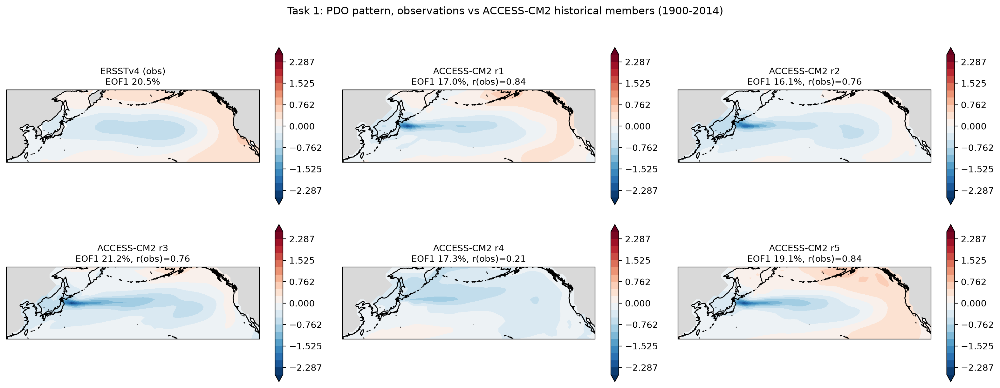

**图 6　ACCESS-CM2 五成员与观测 PDO 对照。1900—2014 年；历史 r1–r5。  数据来源：A：ACCESS 海温/降水五成员资料，现行 EOF1/线性去趋势流程。

|历史成员|EOF1 方差贡献（%）|PDO 型与观测相关，面积加权|正/负位相夏季数|降水 D 与观测相关，未加权|
|---|---:|---:|---:|---:|
|r1|17.0|0.844|62/45|−0.170|
|r2|16.1|0.764|57/50|−0.055|
|r3|21.2|0.760|54/53|0.204|
|r4|17.3|0.205|55/52|−0.228|
|r5|19.1|0.842|50/57|0.120|

观测 EOF1 贡献为 20.5%，PDO 正/负位相为 53/54 个夏季。模式降水合成型与观测相关总体较弱，r1 和 r5 的海温型相关均超过 0.84，但降水相关分别仅为 −0.170 和 0.120。图 7—8 表明，主要偏差涉及异常中心位置及正负配置，不能用“模式已经再现 PDO”替代对降水联系的检验。

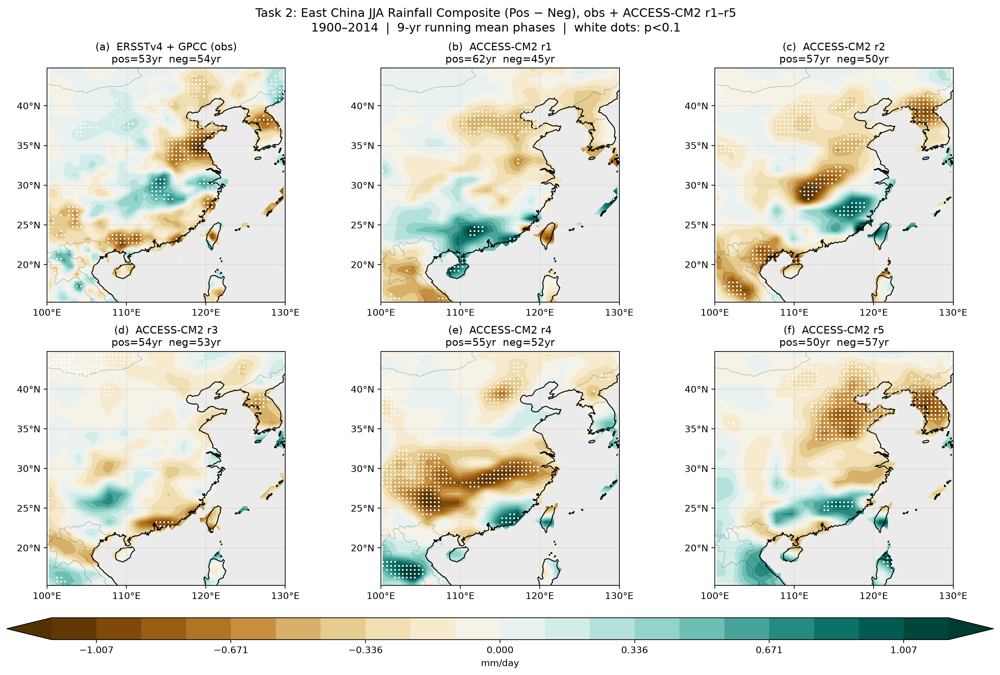

**图 7　ACCESS-CM2 五成员与观测降水合成差对照。1900—2014 年；历史 r1–r5。 仅陆地；降水异常/合成差为 mm/day，成员方差为 (mm/day)²。白点若存在，表示未校正自相关和多重比较的逐格点 p<0.1。 数据来源：A：ACCESS 海温/降水五成员资料，现行 EOF1/线性去趋势流程。

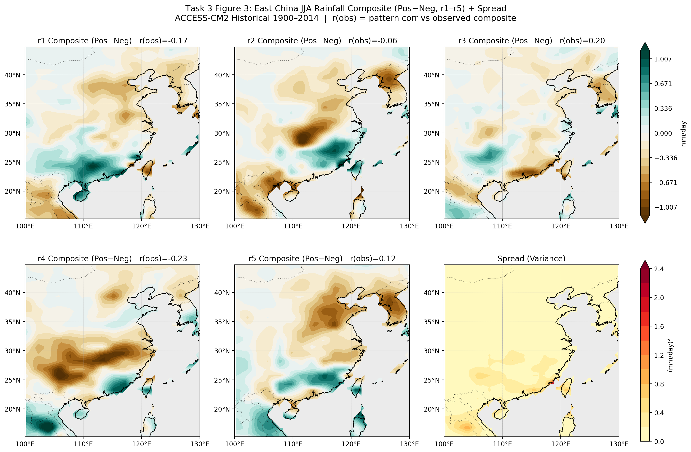

**图 8　ACCESS-CM2 历史降水合成差及成员方差。1900—2014 年；历史 r1–r5。 仅陆地；降水异常/合成差为 mm/day，成员方差为 (mm/day)²。面板 r(obs) 为各成员合成差与观测合成差的空间相关。 数据来源：A：ACCESS 海温/降水五成员资料，现行 EOF1/线性去趋势流程。

图 8 标注的 r(obs) 是各成员降水 D 与观测的相关，依次为 −0.170、−0.055、0.204、−0.228、0.120。各面板展示独立成员的合成差，最后一幅为成员间样本方差。当前结果文件保留的 `best3 = r2/r3/r5` 是未来频谱使用的指定成员，并非按观测技巧评定的“最佳三成员”。Task 4 仍使用全部五成员。

### 5.2　Task 4：未来模态可比性与降水变化

未来 EOF1 型在部分成员中与历史型发生较大变化。SSP585 的 r3、r4 与观测的未加权相关分别为 −0.402、−0.303（图 9）。由于已固定核心区域符号，这不能简单归因于 EOF 的任意正负号，但也不能直接命名为“PDO 反转”：首先需要检验未来 EOF1 是否仍对应历史 PDO，而非其他模态成为第一模态。

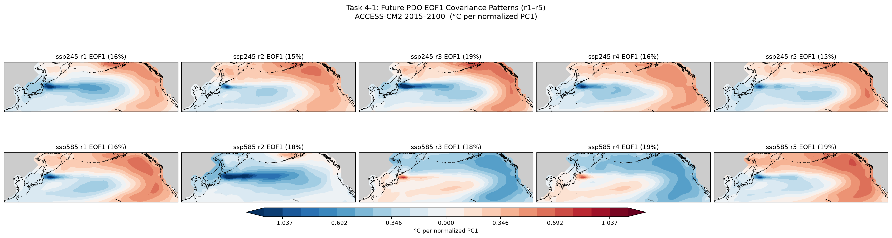

**图 9　ACCESS-CM2 两情景五成员未来 PDO 空间型。2015—2100 年；SSP245、SSP585，r1–r5。  数据来源：A：ACCESS 海温/降水五成员资料，现行 EOF1/线性去趋势流程。

|情景|成员|EOF1 方差贡献（%）|PDO 型与观测相关，未加权|正/负夏季数|未来 D 与自身历史 D 的空间相关|
|---|---|---:|---:|---:|---:|
|SSP245|r1|15.79|0.696|38/40|−0.089|
|SSP245|r2|15.05|0.418|41/37|−0.086|
|SSP245|r3|18.53|0.611|36/42|0.234|
|SSP245|r4|16.47|0.511|39/39|−0.126|
|SSP245|r5|15.46|0.557|40/38|0.131|
|SSP585|r1|16.35|0.423|30/48|0.333|
|SSP585|r2|17.99|0.734|45/33|−0.346|
|SSP585|r3|18.06|−0.402|50/28|0.153|
|SSP585|r4|18.96|−0.303|45/33|−0.124|
|SSP585|r5|19.33|0.453|30/48|0.191|

表末列由已保存 NetCDF 重新计算，使用相同陆地有效格点的未加权相关，见[数值复核](../results/report_audit_2026-11-23.json)。各成员未来 D 与自身历史 D 的相关在 SSP245 为 −0.126—0.234，SSP585 为 −0.346—0.333，显示历史降水合成型难以简单外推至未来。这些相关值未附带考虑空间相关尺度的显著性检验。

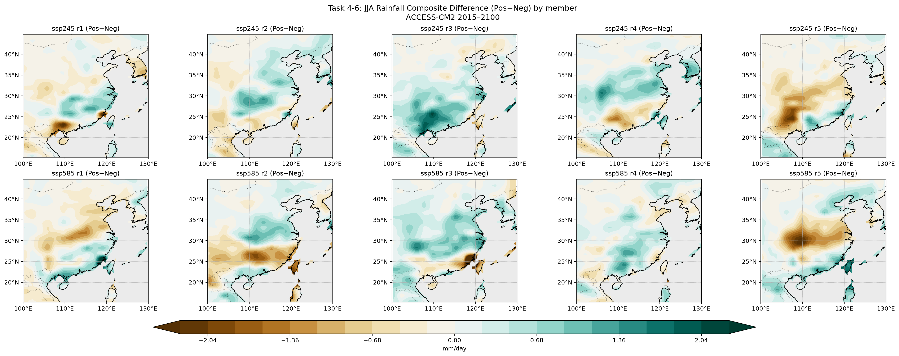

**图 10　ACCESS-CM2 两情景五成员降水合成差。2015—2100 年；SSP245、SSP585，r1–r5。 仅陆地；降水异常/合成差为 mm/day，成员方差为 (mm/day)²。白点若存在，表示未校正自相关和多重比较的逐格点 p<0.1。 数据来源：A：ACCESS 海温/降水五成员资料，现行 EOF1/线性去趋势流程。

图 10 中不同成员的降水合成差缺少统一符号配置。图 11—12 进一步扣除各成员历史 D 后，变化仍呈明显空间异质性与成员分歧。因而现有证据支持“PDO 条件下的降水统计分布具有较大不确定性”，尚不足以支持“全球变暖使 PDO 对东亚降水的影响一致增强/减弱”。差值图幅度大也不等于变化显著，更不等于副高或 PDO 的因果作用增强。

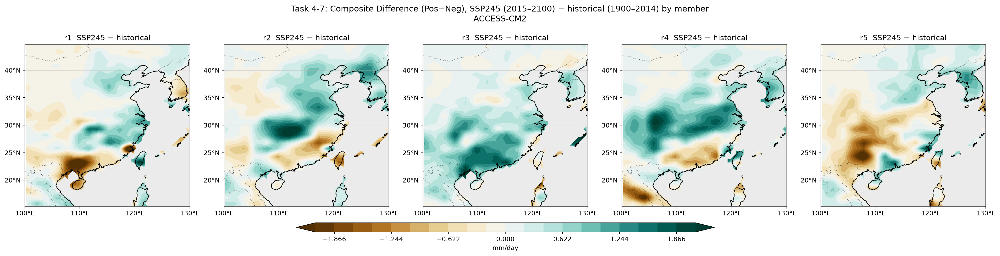

**图 11　ACCESS-CM2 SSP245 相对历史的降水合成差变化。2015—2100 年；SSP245、SSP585，r1–r5。 仅陆地；降水异常/合成差为 mm/day，成员方差为 (mm/day)²。白点若存在，表示未校正自相关和多重比较的逐格点 p<0.1。每个成员自己的未来正减负合成差，减去该成员历史正减负合成差；不是未来减观测，也不是 SSP585−SSP245。 数据来源：A：ACCESS 海温/降水五成员资料，现行 EOF1/线性去趋势流程。

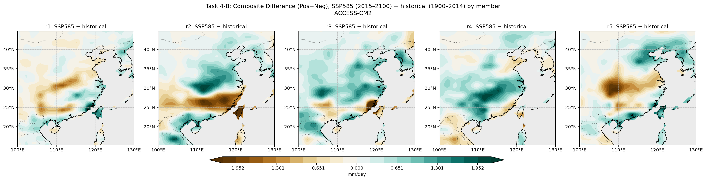

**图 12　ACCESS-CM2 SSP585 相对历史的降水合成差变化。2015—2100 年；SSP245、SSP585，r1–r5。 仅陆地；降水异常/合成差为 mm/day，成员方差为 (mm/day)²。白点若存在，表示未校正自相关和多重比较的逐格点 p<0.1。每个成员自己的未来正减负合成差，减去该成员历史正减负合成差；不是未来减观测，也不是 SSP585−SSP245。 数据来源：A：ACCESS 海温/降水五成员资料，现行 EOF1/线性去趋势流程。

## 6　Task 5：周期诊断是否有助于研究

### 6.1　借鉴的内容与适用范围

Veiga 等（2020）的原文研究大西洋经向模态（AMM），用户提供的 Figure 1 截图见附录图 A53。其海温—近地面风场最大协方差分析（MCA）、成对时间系数和红噪声谱检验构成了完整的耦合模态描述。本项目借鉴的是把空间型、时间演变和频谱联系起来的诊断逻辑；实际 PDO 分析为单一海温 EOF，没有执行原文的海温—风场 MCA，也不能把 AMM 的周期或机理直接转移到 PDO。

Task 5 对本研究有帮助，因为九年平滑位相合成依赖指数的低频持续性：如果未来 PC1 的方差更多出现在较短时间尺度，或者不同成员主导时间尺度不同，则相同平滑窗口划分出的位相组可能有不同含义。功率谱能揭示这一问题，但仅凭谱图不能解释区域降水如何产生，也不能证明低频变化就是 PDO 的独立动力机制。

### 6.2　实际结果

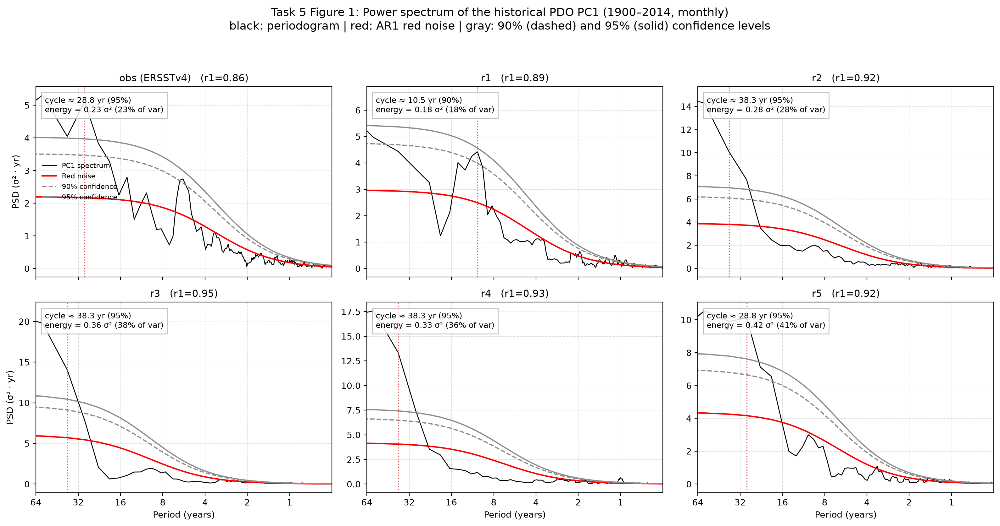

**图 13　观测与 ACCESS-CM2 历史 PDO 功率谱。历史 1900—2014 年；未来 2015—2100 年。 使用未经九年平滑的标准化月度 PC1。历史包含 r1–r5，未来只包含指定的 r2、r3、r5。红噪声阈值是近似逐频点阈值，峰带随序列改变。 数据来源：A：ACCESS 海温/降水五成员资料，现行 EOF1/线性去趋势流程。

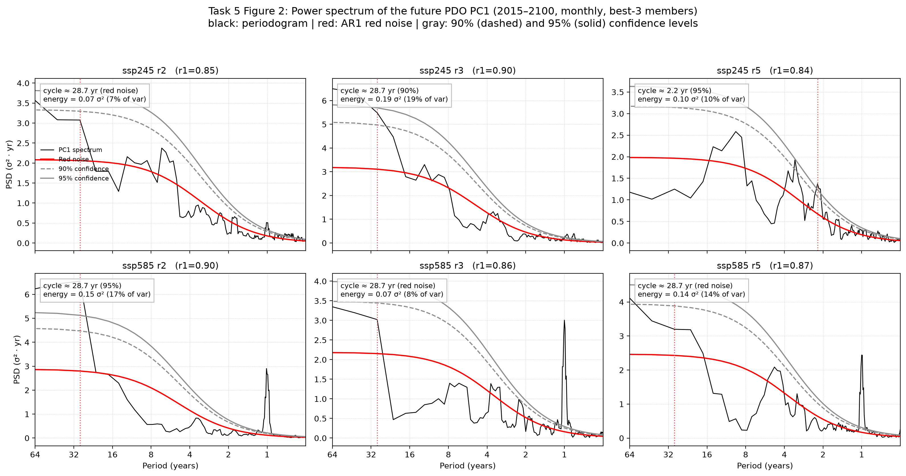

**图 14　ACCESS-CM2 未来 PDO 功率谱。历史 1900—2014 年；未来 2015—2100 年。 使用未经九年平滑的标准化月度 PC1。历史包含 r1–r5，未来只包含指定的 r2、r3、r5。红噪声阈值是近似逐频点阈值，峰带随序列改变。 数据来源：A：ACCESS 海温/降水五成员资料，现行 EOF1/线性去趋势流程。

|序列|主谱峰周期（年）|所用逐频点阈值|积分频带对应周期（年）|峰带方差占比（%）|
|---|---:|---|---|---:|
|ERSSTv4|28.75|95%|14.38—57.50|22.85|
|历史 r1|10.45|90%|9.58—14.38|17.54|
|历史 r2|38.33|95%|28.75—57.50|28.14|
|历史 r3|38.33|95%|28.75—57.50|37.91|
|历史 r4|38.33|95%|28.75—57.50|35.66|
|历史 r5|28.75|95%|16.43—57.50|40.61|
|SSP245 r2|28.67|仅超过背景|28.67—43.00|7.32|
|SSP245 r3|28.67|90%|21.50—43.00|18.93|
|SSP245 r5|2.21|95%|2.05—2.46|10.18|
|SSP585 r2|28.67|95%|28.67—43.00|16.67|
|SSP585 r3|28.67|仅超过背景|28.67—43.00|7.65|
|SSP585 r5|28.67|仅超过背景|17.20—43.00|14.00|

“仅超过背景”不表示通过 90% 显著性阈值。历史 r2—r4 的 38.33 年恰为 115 年记录的三分之一，未来多个序列的 28.67 年也恰为 86 年记录的三分之一，均落在搜索周期上界。它们可能受到记录长度、频率分辨率和搜索规则影响，不宜作为精确的固有振荡周期。

为避免用历史五成员与未来三成员直接比较，本次还针对共同的 r2/r3/r5 复核了峰带占比：历史平均 35.55%，SSP245 为 12.14%，SSP585 为 12.77%。这些数值仍然对应不同的频带，且 SSP245 r5 的主峰为约 2.21 年，并非年代际尺度；因此这一比较只能描述所选峰带方差的变化，不能据此宣布 PDO 年代际能量显著减少。若要正式检验，应采用等长窗口、固定年代际频带及考虑自相关的重采样，并同时检查未标准化海温模态幅度。图中若出现接近一年周期的异常尖峰，也需作单独的谱估计诊断，不能在已去月气候态的前提下未经检验便归因于“残余季节循环”。

## 7　Task 6：PDO 位相下的副高位置

### 7.1　固定阈值的局限

NCEP 正、负 PDO 位相合成的 5870 gpm 西界分别为 125°E 和 135°E，提示该资料和分类下正位相对应较偏西的轮廓，但没有针对西界位相差进行显著性检验。模式历史场则难以统一采用此阈值：r1、r2 正负位相在诊断区域内均无达到阈值的格点，r5 仅正位相达到。未来两情景各成员的固定阈值西界均落在约 100.3°E 的区域边缘，指标已受边界截断，不能解释为精确的副高西脊点。

模式历史高度场的区域平均偏差约为 −20.9、−20.2、−16.7 gpm（r1/r2/r5），但偏差并非处处相同。未来高度场整体抬升又进一步改变固定等值线的位置。这说明固定阈值图包含平均态和热力背景变化，不能把全部轮廓变化都解释为 PDO 相关动力环流变化。附录同时保留两种绘图流程中的原始 5870 gpm 图，以展示这一诊断困难。

### 7.2　等面积阈值结果

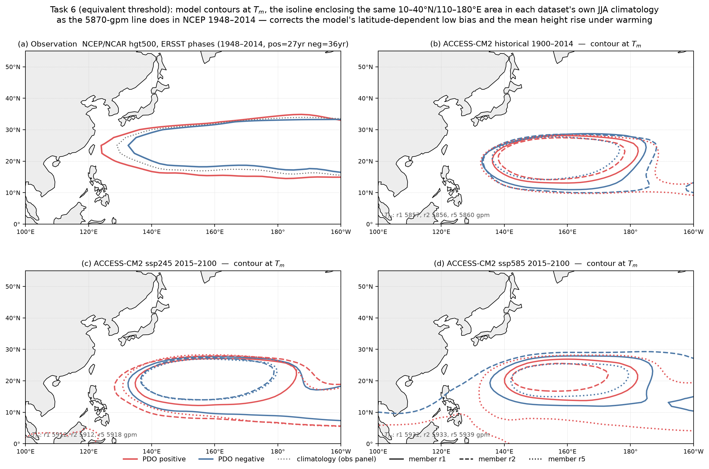

**图 15　等面积阈值副高位相轮廓总览。NCEP 1948—2014 年；ACCESS 历史 1900—2014 年，未来 2015—2100 年；r1、r2、r5。 模式使用各数据集自身气候态的等面积阈值 Tm；观测仍为 5870 gpm。此方法不是加一个常数的高度偏差订正。 数据来源：Z-current：现行 500 hPa 流程。

|试验|成员|Tm（gpm）|正位相西界（°E）|负位相西界（°E）|正位相相对负位相|
|---|---|---:|---:|---:|---|
|历史|r1|5856.6|137.8|134.1|偏东|
|历史|r2|5855.9|139.7|134.1|偏东|
|历史|r5|5860.1|134.1|137.8|偏西|
|SSP245|r1|5912.2|135.9|134.1|偏东|
|SSP245|r2|5912.4|128.4|137.8|偏西|
|SSP245|r5|5918.2|132.2|137.8|偏西|
|SSP585|r1|5932.1|141.6|135.9|偏东|
|SSP585|r2|5933.1|143.4|113.4|偏东|
|SSP585|r5|5938.9|132.2|143.4|偏西|

等面积轮廓使历史与未来的相对形态更容易辨认，但成员对 PDO 位相的响应方向仍不一致。SSP585 r2 的位相西界差约 30°，还可能涉及轮廓形状及最西格点所属区域改变；由于算法没有筛选连通副高主体，不能仅据一个最西格点将其解释为整座副高整体平移。Task 6 因而提供了环流联系的线索及指标敏感性证据，没有解决降水结果缺乏稳健变化的问题。

本次使用 Z-full 早期流程保存的年度高度场，重新构造等面积阈值和正负位相西界，九组数值均复现当前汇总的保存精度。这支持两套 Task 6 图主要反映方法和展示方式的变化，而非两批独立资料带来的重复验证。

## 8　Task 7：副高年际变率与强事件的未来变化

### 8.1　再分析中的指数检验

ERA5 流函数 EOF1 解释约 77.86% 的区域夏季方差，EOF2 约为 9.12%，PC1 与区域流函数平均的相关为 0.953。强事件出现在 1995、1998、2010、2020 年（图 16）。NCEP/NCAR 对照中 EOF1 约为 75.85%，强事件为 1988、1998、2010、2020 年。两套资料的大尺度模态具有一致性，但阈值事件清单并不完全相同，说明临界事件识别对资料和处理方式有敏感性。

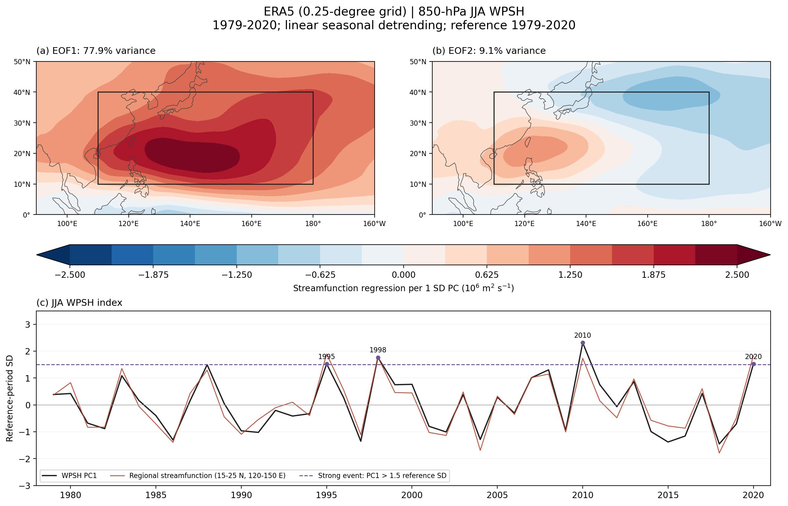

**图 16　ERA5 副高流函数 EOF 与强事件。ERA5 0.25° 全球 850 hPa 月风，1979—2020 年，共 42 个夏季。 此指数衡量副高环流年际变率，与 Task 6 的 500 hPa 位相合成诊断不同。强事件为历史基准标准化指数超过 1.5。 数据来源：W：850 hPa 风场与流函数 EOF 分析。

Yang 等（2022）关于副高变率增强的结论为本项目提供了比较背景，但其多模式集合、时间范围及具体处理与本项目不同。本文的强事件结果来自自己的指数定义和资料，不能直接沿用原论文的百分比增幅，也不能称为对其全部分析的严格复现。

### 8.2　ACCESS-CM2 三成员、两情景结果

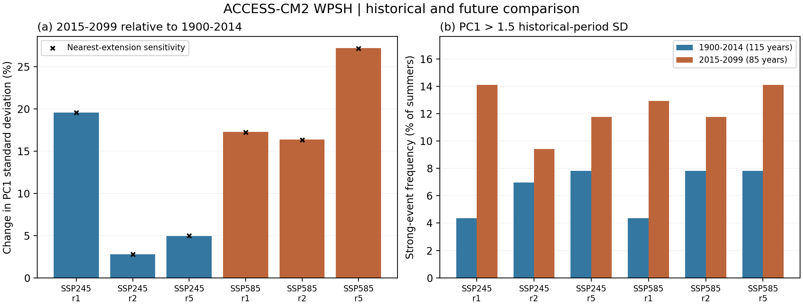

**图 17　ACCESS-CM2 副高指数历史与未来的变率和强事件比较。ACCESS r1、r2、r5，SSP245/SSP585；1900—2100 年，历史标准化基准 1900—2014 年。 此指数衡量副高环流年际变率，与 Task 6 的 500 hPa 位相合成诊断不同。强事件为历史基准标准化指数超过 1.5。 数据来源：W：850 hPa 风场与流函数 EOF 分析。

|情景|成员|EOF1 贡献（%）|未来标准差变化|历史/未来强事件次数|历史/未来强事件发生率|
|---|---|---:|---:|---:|---:|
|SSP245|r1|76.02|+19.98%|5/12|4.35%/13.95%|
|SSP245|r2|73.15|+2.41%|8/8|6.96%/9.30%|
|SSP245|r5|72.50|+4.39%|9/10|7.83%/11.63%|
|SSP585|r1|74.30|+16.65%|5/11|4.35%/12.79%|
|SSP585|r2|73.55|+15.83%|9/10|7.83%/11.63%|
|SSP585|r5|74.82|+27.34%|9/12|7.83%/13.95%|

六组结果的未来标准差及强事件发生率均高于历史值。其中 SSP245 r2 的事件次数同为 8 次，但未来窗口较短，因此发生率仍增加。与降水位相合成相比，副高流函数指数呈现更一致的样本内变化方向。不过，r1 在 SSP245 下的标准差增幅大于 SSP585，说明幅度并不对所有成员都随情景强迫单调增加。

调和延拓与最近邻延拓的 PC1 相关均超过 0.99999，六组强事件年份不变；ERA5 人工遮蔽试验中相关约为 0.99986，参考标准差单位的 RMSE 约为 0.0165。这说明所检验的延拓选择对当前指数影响很小，不表示其他结构误差、资料差异和采样误差均已消除。具体记录见[模式结果表](../results/task7_wpsh_eof/access_summary.csv)和[延拓检验](../results/task7_wpsh_eof/wind_fill_benchmark.json)。

本项目尚未对标准差比值和事件率差异给出置信区间或正式显著性检验，且只有单模式三个成员。因此应将结论表述为“所分析成员中一致增加”，而不是“已经证明所有模式下显著增加”。Task 7 分析的是整体副高年际变率，没有按 PDO 条件分别估计未来变化，不能据此反推 PDO 对副高或降水的影响增强。

## 9　综合讨论

### 9.1　从海温型到降水型，为什么结论逐步变得不确定

本研究中，较好的 PDO 空间型模拟并未转化为同等可靠的降水合成型。一方面，降水依赖环流与水汽输送等过程，不仅取决于海温模态是否存在；另一方面，九年平滑后的位相合成只有有限的独立低频变化片段。不同成员的相位持续时间、异常幅度和实际抽样年份均不同，即使样本数接近，也未必具有相同的统计信息量。多成员图的作用在于揭示这种离散度，而不是用集合平均掩盖它。

两模式都未在当前降水图中呈现清晰一致的未来趋势，这说明结论需要对成员和方法保持谨慎；它并不证明全球变暖对 PDO—降水关系没有影响。MIROC6 与 ACCESS 的成员数、未来选取、陆地掩膜和部分预处理不同，也不能由图面差异直接量化模式优劣或模式结构不确定性。

### 9.2　Task 5—7 对主问题的补充

Task 5 提供时间尺度证据，提示同一九年滤波定义在不同序列中的含义可能改变；Task 6 提供空间环流线索，同时暴露绝对高度阈值在增暖情景下的适用性问题；Task 7 则显示一个相对明确的样本内结果，即副高年际变率及强事件发生率增加。三者补充了 Task 1—4，但尚未构成闭合的“PDO 改变—副高改变—降水改变”机制链。

副高指数变率增加与 PDO 条件降水联系不稳定可以同时发生，因为前者描述整体环流的年际波动，后者描述按低频 PDO 分类后的条件平均差，时间尺度和统计对象不同。进一步建立联系，需要在一致时段上同时分析 PDO、ENSO、副高与降水，检验偏相关、交互作用及水汽输送，而不是仅将几类图的视觉一致当作归因证据。

### 9.3　研究限制与后续优先工作

首先，应检验模态可比性。将未来海温投影到固定历史或观测 PDO 型，并与逐时段重新计算 EOF 的结果比较，可区分“同一模态强弱改变”和“主导空间型改变”。其次，采用同长度窗口、固定频带和按年块重采样，检验频谱、降水合成差、副高标准差及事件率的置信区间；降水还需比较去趋势与未去趋势结果，并控制空间多重检验。

第三，在副高轮廓指标中加入连通区域识别，并对历史、未来采用一致的诊断窗口，避免把边界截断或孤立格点当作整体西伸。第四，通过 PDO 与 ENSO 的条件分析、850 hPa 风和水汽通量回归检验环流路径。最后，扩大到统一预处理的多模式、多成员集合，才有条件进一步分离内部变率、模式结构与情景差异。上述工作属于下一阶段建议，本文没有将它们写作已经完成的结果。

## 10　结论

1. 本项目完成了从 MIROC6 Task 1—4 到 ACCESS-CM2 补充分析，再到频谱和副高诊断的研究流程。MIROC6 历史十成员与未来三成员的实际使用范围已分别确认，ACCESS 两次 zg 下载属于同源原始资料的子集与全层形式。
2. PDO 海温空间型的再现优于相应降水联系的再现。ACCESS 历史成员降水合成差与观测相关仅为 −0.228—0.204，说明不能用海温型技巧替代降水遥相关技巧。
3. 在当前 MIROC6 和 ACCESS-CM2 的未来样本中，PDO 位相降水分布及其相对历史变化具有明显的成员分歧；尚未识别出跨成员一致的增强或减弱方向。这里“分歧明显”是结果描述，不是未来差异通过统计显著性检验的声明。
4. Task 5 对识别指数时间尺度和诊断局限有帮助，但不同频带、不同长度的标准化谱不能支持 PDO 绝对能量显著下降的结论。Task 6 表明固定高度阈值受平均态与增暖背景影响，等面积阈值下的 PDO 位相西界变化仍不一致。
5. Task 7 的六组 ACCESS-CM2 结果均显示未来副高指数标准差及强事件发生率增加，标准差增幅为 2.4%—27.3%。这一方向一致性限于当前单模式三成员样本，并未证明 PDO 是其原因。未来需要结合模态匹配、统计检验及联合环流—水汽分析，进一步判断 PDO—东亚降水关系的稳健变化。

## 参考文献

以下列出本文实际借鉴的背景、方法、模式及数据资料。用户给出的两条 Yang 等论文路径相同，仅列一次；Dong 论文文件名含 2015，正式卷期年份为 2016；Veiga 的 Atmosphere 论文于 2019 年在线发表，卷期归入 2020 年。开题 Review、Proposal 和四份 Task 文档用于重建项目设计，不作为独立的外部科学证据。

1. Yu, L. (2013). Potential correlation between the decadal East Asian summer monsoon variability and the Pacific decadal oscillation. *Atmospheric and Oceanic Science Letters*, 6(5), 394–397. [DOI](https://doi.org/10.3878/j.issn.1674-2834.13.0040).
2. Dong, X. (2016). Influences of the Pacific Decadal Oscillation on the East Asian Summer Monsoon in non-ENSO years. *Atmospheric Science Letters*, 17, 115–120. [DOI](https://doi.org/10.1002/asl.634).
3. Reichle, D. E. (2023). Climate and climate models. In *The Global Carbon Cycle and Climate Change*, Chapter 13, pp. 389–452. Elsevier. [DOI](https://doi.org/10.1016/B978-0-443-18775-9.00010-3).
4. Liu, Y., Goodrick, S., Williams, M., & Zhang, A. (2024). Climate change and variability overview. In S. G. McNulty (Ed.), *Future Forests: Mitigation and Adaptation to Climate Change*, pp. 7–48. Elsevier. [DOI](https://doi.org/10.1016/B978-0-323-90430-8.00010-1).
5. Lehner, F., & Deser, C. (2023). Origin, importance, and predictive limits of internal climate variability. *Environmental Research: Climate*, 2, 023001. [DOI](https://doi.org/10.1088/2752-5295/accf30).
6. Veiga, S. F., Giarolla, E., Nobre, P., & Nobre, C. A. (2020). Analyzing the influence of the North Atlantic Ocean variability on the Atlantic Meridional Mode on decadal time scales. *Atmosphere*, 11(1), 3. [DOI](https://doi.org/10.3390/atmos11010003).
7. Yang, K., Cai, W., Huang, G., Hu, K., Ng, B., & Wang, G. (2022). Increased variability of the western Pacific subtropical high under greenhouse warming. *Proceedings of the National Academy of Sciences*, 119(23), e2120335119. [DOI](https://doi.org/10.1073/pnas.2120335119).
8. Newman, M., et al. (2016). The Pacific Decadal Oscillation, revisited. *Journal of Climate*, 29, 4399–4427. [DOI](https://doi.org/10.1175/JCLI-D-15-0508.1).
9. Li, H., Zhai, P., Chen, Y., & Lu, E. (2018). Potential influence of the East Asia–Pacific teleconnection pattern on persistent precipitation in South China: Implications of atypical Yangtze River Valley cases. *Weather and Forecasting*, 33, 267–282. [DOI](https://doi.org/10.1175/WAF-D-17-0011.1).
10. Zhang, Z., Sun, X., & Yang, X.-Q. (2018). Understanding the interdecadal variability of East Asian summer monsoon precipitation: Joint influence of three oceanic signals. *Journal of Climate*, 31, 5485–5506. [DOI](https://doi.org/10.1175/JCLI-D-17-0657.1).
11. Veiga, S. F., & Yuan, H. (2022). The response of the East Asian summer rainfall to more extreme El Niño events in future climate scenarios. *Atmospheric Research*, 268, 105983. [DOI](https://doi.org/10.1016/j.atmosres.2021.105983).
12. Wu, B., & Jiang, D. (2024). Unstable interdecadal relationship between the Pacific Decadal Oscillation and eastern China summer precipitation in simulated warm interglacial epochs and twenty-first century. *Global and Planetary Change*, 237, 104458. [DOI](https://doi.org/10.1016/j.gloplacha.2024.104458).
13. Tatebe, H., et al. (2019). Description and basic evaluation of simulated mean state, internal variability, and climate sensitivity in MIROC6. *Geoscientific Model Development*, 12, 2727–2765. [DOI](https://doi.org/10.5194/gmd-12-2727-2019).
14. Bi, D., et al. (2020). Configuration and spin-up of ACCESS-CM2, the new generation Australian Community Climate and Earth System Simulator Coupled Model. *Journal of Southern Hemisphere Earth Systems Science*, 70, 225–251. [DOI](https://doi.org/10.1071/ES19040).
15. Eyring, V., et al. (2016). Overview of the Coupled Model Intercomparison Project Phase 6 (CMIP6) experimental design and organization. *Geoscientific Model Development*, 9, 1937–1958. [DOI](https://doi.org/10.5194/gmd-9-1937-2016).
16. O’Neill, B. C., et al. (2016). The Scenario Model Intercomparison Project (ScenarioMIP) for CMIP6. *Geoscientific Model Development*, 9, 3461–3482. [DOI](https://doi.org/10.5194/gmd-9-3461-2016).
17. Huang, B., et al. (2015). Extended Reconstructed Sea Surface Temperature version 4 (ERSST.v4). Part I: Upgrades and intercomparisons. *Journal of Climate*, 28, 911–930. [DOI](https://doi.org/10.1175/JCLI-D-14-00006.1).
18. Schneider, U., Becker, A., Finger, P., Meyer-Christoffer, A., & Ziese, M. (2018). *GPCC Full Data Monthly Product Version 2018 at 0.5°: Monthly Land-Surface Precipitation from Rain-Gauges built on GTS-based and Historical Data* [Dataset]. Deutscher Wetterdienst. [DOI](https://doi.org/10.5676/DWD_GPCC/FD_M_V2018_050).
19. Hersbach, H., et al. (2020). The ERA5 global reanalysis. *Quarterly Journal of the Royal Meteorological Society*, 146, 1999–2049. [DOI](https://doi.org/10.1002/qj.3803).
20. Kalnay, E., et al. (1996). The NCEP/NCAR 40-Year Reanalysis Project. *Bulletin of the American Meteorological Society*, 77, 437–472. [DOI](https://doi.org/10.1175/1520-0477%281996%29077%3C0437%3ATNYRP%3E2.0.CO%3B2).（页码按出版商在线记录；部分数据说明列作 437–471。）
21. Gilman, D. L., Fuglister, F. J., & Mitchell, J. M., Jr. (1963). On the power spectrum of “red noise”. *Journal of the Atmospheric Sciences*, 20, 182–184. [DOI](https://doi.org/10.1175/1520-0469%281963%29020%3C0182%3AOTPSON%3E2.0.CO%3B2).
22. Dawson, A. (2016). eofs: A library for EOF analysis of meteorological, oceanographic, and climate data. *Journal of Open Research Software*, 4(1), e14. [DOI](https://doi.org/10.5334/jors.122).

**资料与代码说明：**模式资料通过 ESGF 获取；观测及早期 MIROC6 资料与输出同时参考用户提供的 [Google Drive 文件夹](https://drive.google.com/drive/folders/1hFPx8SuuVn399gsVioY4fCWsB1HON10F)及本地副本，具体可验证证据以来源附录为准。NCEP/NCAR 资料由 NOAA PSL 提供。分析代码与结果存于 [Sandro 仓库](https://github.com/xiruozhao170-crypto/Sandro)。本次未将云盘中未逐一读取的其他文件视为已经验证的输入。
