# 报告图像附录：完整候选图册

版本：2026-11-23。配套[报告正文](Report_2026-11-23.md)与[数据来源核对](Report_data_provenance_2026-11-23.md)。

正文嵌入 17 张研究图，本附录嵌入其余 48 张研究图和 1 张方法参考图，合计保留 65 张研究图。这里保留单图与组合图等不同排版，便于最后选图；它们不是相互独立的证据。所有 Task 1 区域检查图、MIROC6 T4-5/T4-7 和 ACCESS T4-5 成员平均降水图均未纳入。成员间方差图用于不确定性诊断，予以保留。

2026-11-25 已将 ACCESS T4-5 成员平均降水图从仓库删除并停用生成；正文图 8 改标各成员与观测的相关 r(obs)。逐成员降水图及方差图继续保留，收录图数不变。

2026-11-28 将原图 A25–A29 合并为一张五成员总图，研究图文件数由 69 减为 65；保留后续图号以便追溯。

图中英文标签对应原有分析内容，解释以中文图注为准。图片均可点击查看原分辨率；MIROC6 除最早两张 Task 1 图外使用硬盘中的高清输出。正文和本附录的文件、来源和 SHA256 见[图像清单](../results/report_figure_manifest_2026-11-23.json)。

## 图像索引

|编号|内容|位置|
|---|---|---|
|图 1|[MIROC6 单成员与 ERSSTv4 的 PDO 空间型](../figures/task1-4/report_miroc6/MIROC6_01_cell_004_output_03.png)|正文|
|图 A01|[MIROC6 单成员与 ERSSTv4 的月度 PC1](../figures/task1-4/report_miroc6/MIROC6_02_cell_004_output_04.png)|本附录|
|图 A02|[GPCC 正 PDO 位相降水异常](../figures/task1-4/report_miroc6/MIROC6_03_cell_005_output_01.png)|本附录|
|图 A03|[GPCC 负 PDO 位相降水异常](../figures/task1-4/report_miroc6/MIROC6_04_cell_005_output_03.png)|本附录|
|图 A04|[GPCC 正减负位相降水合成差](../figures/task1-4/report_miroc6/MIROC6_05_cell_005_output_05.png)|本附录|
|图 A05|[GPCC 位相降水三联图](../figures/task1-4/report_miroc6/MIROC6_06_cell_005_output_07.png)|本附录|
|图 A06|[MIROC6 r10 正位相降水异常](../figures/task1-4/report_miroc6/MIROC6_07_cell_005_output_09.png)|本附录|
|图 A07|[MIROC6 r10 负位相降水异常](../figures/task1-4/report_miroc6/MIROC6_08_cell_005_output_11.png)|本附录|
|图 A08|[MIROC6 r10 正减负位相降水合成差](../figures/task1-4/report_miroc6/MIROC6_09_cell_005_output_13.png)|本附录|
|图 A09|[MIROC6 r10 位相降水三联图](../figures/task1-4/report_miroc6/MIROC6_10_cell_005_output_15.png)|本附录|
|图 A10|[观测与 MIROC6 r10 的 PDO 平滑序列](../figures/task1-4/report_miroc6/MIROC6_11_cell_005_output_17.png)|本附录|
|图 2|[观测与 MIROC6 r10 的降水位相对照](../figures/task1-4/report_miroc6/MIROC6_12_cell_005_output_19.png)|正文|
|图 3|[MIROC6 十成员历史 PDO 空间型及成员方差](../figures/task1-4/report_miroc6/MIROC6_13_Task3_Figure1_PDO_EOF1_Spread_4x3.png)|正文|
|图 A11|[MIROC6 十成员历史 PDO 时间序列](../figures/task1-4/report_miroc6/MIROC6_14_Task3_Figure2_PC1_5x2.png)|本附录|
|图 4|[MIROC6 十成员历史降水合成差及成员方差](../figures/task1-4/report_miroc6/MIROC6_15_Task3_Figure3_Rainfall_Composite_Spread_4x3.png)|正文|
|图 A12|[MIROC6 正、负位相降水的成员方差](../figures/task1-4/report_miroc6/MIROC6_16_Task3_Figure4_Positive_Negative_Rainfall_Spread_1x2.png)|本附录|
|图 A13|[MIROC6 四情景三成员未来 PDO 空间型](../figures/task1-4/report_miroc6/MIROC6_17_Task4_T4-1_Future_PDO_EOF1_SSP_by_member_4x3.png)|本附录|
|图 A14|[MIROC6 四情景三成员未来 PC1](../figures/task1-4/report_miroc6/MIROC6_18_Task4_T4-2_Future_PC1_SSP_by_member_4x3.png)|本附录|
|图 A15|[MIROC6 四情景三成员正位相降水异常](../figures/task1-4/report_miroc6/MIROC6_19_Task4_T4-3_Positive_Phase_Rainfall_SSP_by_member_4x3.png)|本附录|
|图 A16|[MIROC6 四情景三成员负位相降水异常](../figures/task1-4/report_miroc6/MIROC6_20_Task4_T4-4_Negative_Phase_Rainfall_SSP_by_member_4x3.png)|本附录|
|图 5|[MIROC6 四情景三成员正减负位相降水合成差](../figures/task1-4/report_miroc6/MIROC6_22_Task4_T4-6_Composite_Difference_SSP_by_member_4x3.png)|正文|
|图 A17|[ACCESS-CM2 r1 历史 PDO 空间型与 PC1](../figures/task1-4/report_access/task1_pdo_access_r1.png)|本附录|
|图 A18|[ACCESS-CM2 r2 历史 PDO 空间型与 PC1](../figures/task1-4/report_access/task1_pdo_access_r2.png)|本附录|
|图 A19|[ACCESS-CM2 r3 历史 PDO 空间型与 PC1](../figures/task1-4/report_access/task1_pdo_access_r3.png)|本附录|
|图 A20|[ACCESS-CM2 r4 历史 PDO 空间型与 PC1](../figures/task1-4/report_access/task1_pdo_access_r4.png)|本附录|
|图 A21|[ACCESS-CM2 r5 历史 PDO 空间型与 PC1](../figures/task1-4/report_access/task1_pdo_access_r5.png)|本附录|
|图 A22|[ERSSTv4 PDO 空间型与 PC1](../figures/task1-4/report_access/task1_pdo_ersst.png)|本附录|
|图 6|[ACCESS-CM2 五成员与观测 PDO 对照](../figures/task1-4/report_access/task1_pdo_members.png)|正文|
|图 7|[ACCESS-CM2 五成员与观测降水合成差对照](../figures/task1-4/report_access/task2_composite_obs_members.png)|正文|
|图 A23|[ACCESS 流程中的 GPCC 位相降水三联图](../figures/task1-4/report_access/task2_obs_three_panels.png)|本附录|
|图 A24|[ACCESS-CM2 与观测 PDO 时间序列](../figures/task1-4/report_access/task2_pdo_timeseries.png)|本附录|
|图 A25–A29|[ACCESS-CM2 R1–R5 历史位相降水总图](../figures/task1-4/report_access/task2_members_three_panels.png)|本附录|
|图 A30|[ACCESS-CM2 历史 PDO 空间型及成员方差](../figures/task1-4/report_access/Task3_Figure1_PDO_EOF1_Spread.png)|本附录|
|图 A31|[ACCESS-CM2 历史 PC1 与九年平滑序列](../figures/task1-4/report_access/Task3_Figure2_PC1.png)|本附录|
|图 8|[ACCESS-CM2 历史降水合成差及成员方差](../figures/task1-4/report_access/Task3_Figure3_Rainfall_Composite_Spread.png)|正文|
|图 A32|[ACCESS-CM2 正、负位相降水的成员方差](../figures/task1-4/report_access/Task3_Figure4_Positive_Negative_Rainfall_Spread.png)|本附录|
|图 9|[ACCESS-CM2 两情景五成员未来 PDO 空间型](../figures/task1-4/report_access/Task4_T4-1_Future_PDO_EOF1_by_member.png)|正文|
|图 A33|[ACCESS-CM2 两情景五成员未来 PC1](../figures/task1-4/report_access/Task4_T4-2_Future_PC1_by_member.png)|本附录|
|图 A34|[ACCESS-CM2 两情景五成员正位相降水异常](../figures/task1-4/report_access/Task4_T4-3_Positive_Phase_Rainfall_by_member.png)|本附录|
|图 A35|[ACCESS-CM2 两情景五成员负位相降水异常](../figures/task1-4/report_access/Task4_T4-4_Negative_Phase_Rainfall_by_member.png)|本附录|
|图 10|[ACCESS-CM2 两情景五成员降水合成差](../figures/task1-4/report_access/Task4_T4-6_Composite_Difference_by_member.png)|正文|
|图 11|[ACCESS-CM2 SSP245 相对历史的降水合成差变化](../figures/task1-4/report_access/Task4_T4-7_Scenario_Difference_SSP245_minus_Historical.png)|正文|
|图 12|[ACCESS-CM2 SSP585 相对历史的降水合成差变化](../figures/task1-4/report_access/Task4_T4-8_Composite_Difference_SSP585_minus_Historical.png)|正文|
|图 13|[观测与 ACCESS-CM2 历史 PDO 功率谱](../figures/Task5_Figure1_Historical_PC1_Spectrum.png)|正文|
|图 14|[ACCESS-CM2 未来 PDO 功率谱](../figures/Task5_Figure2_Future_PC1_Spectrum.png)|正文|
|图 A36|[PDO 主谱峰周期与峰带方差汇总](../figures/Task5_Figure3_Cycle_Energy_Summary.png)|本附录|
|图 A37|[固定 5870 gpm 副高位相轮廓](../figures/Task6_Figure1_WPSH_5870_JJA.png)|本附录|
|图 A38|[等面积阈值副高逐成员位相轮廓](../figures/Task6_Figure2_WPSH_5870_by_member.png)|本附录|
|图 15|[等面积阈值副高位相轮廓总览](../figures/Task6_Figure3_WPSH_equivalent_threshold.png)|正文|
|图 A39|[早期固定阈值：1948—2014 年共同窗口比较](../figures/task6_wpsh/Figure4_JJA_WPSH_common_period.png)|本附录|
|图 A40|[早期固定阈值：观测与历史正负位相分栏](../figures/task6_wpsh/Figure4_JJA_WPSH_observation_historical_phase_separated.png)|本附录|
|图 A41|[早期固定阈值：观测、历史与未来总览](../figures/task6_wpsh/Figure4_JJA_WPSH_overview.png)|本附录|
|图 A42|[早期固定阈值：三成员逐一对照](../figures/task6_wpsh/Figure4_JJA_WPSH_selected_members.png)|本附录|
|图 A43|[早期固定阈值：SSP245 正负位相分栏](../figures/task6_wpsh/Figure4_JJA_WPSH_ssp245_phase_separated.png)|本附录|
|图 A44|[早期固定阈值：SSP585 正负位相分栏](../figures/task6_wpsh/Figure4_JJA_WPSH_ssp585_phase_separated.png)|本附录|
|图 A45|[ACCESS-CM2 流函数副高指数六组总览](../figures/task7_wpsh_eof/access_overview.png)|本附录|
|图 17|[ACCESS-CM2 副高指数历史与未来的变率和强事件比较](../figures/task7_wpsh_eof/access_period_comparison.png)|正文|
|图 A46|[ACCESS-CM2 SSP245 r1 副高流函数 EOF 与指数](../figures/task7_wpsh_eof/access_ssp245_r1.png)|本附录|
|图 A47|[ACCESS-CM2 SSP245 r2 副高流函数 EOF 与指数](../figures/task7_wpsh_eof/access_ssp245_r2.png)|本附录|
|图 A48|[ACCESS-CM2 SSP245 r5 副高流函数 EOF 与指数](../figures/task7_wpsh_eof/access_ssp245_r5.png)|本附录|
|图 A49|[ACCESS-CM2 SSP585 r1 副高流函数 EOF 与指数](../figures/task7_wpsh_eof/access_ssp585_r1.png)|本附录|
|图 A50|[ACCESS-CM2 SSP585 r2 副高流函数 EOF 与指数](../figures/task7_wpsh_eof/access_ssp585_r2.png)|本附录|
|图 A51|[ACCESS-CM2 SSP585 r5 副高流函数 EOF 与指数](../figures/task7_wpsh_eof/access_ssp585_r5.png)|本附录|
|图 16|[ERA5 副高流函数 EOF 与强事件](../figures/task7_wpsh_eof/era5_1979_2020.png)|正文|
|图 A52|[NCEP/NCAR 副高流函数 EOF 与强事件](../figures/task7_wpsh_eof/ncep_1979_2020.png)|本附录|

## 图 A01　MIROC6 单成员与 ERSSTv4 的月度 PC1

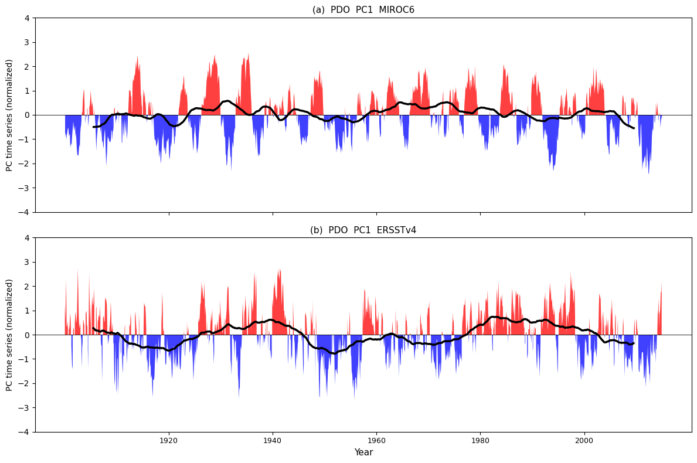

**图 A01　MIROC6 单成员与 ERSSTv4 的月度 PC1。1900—2014 年；Task 1–2 为 r10i1p1f1。  数据来源：M：MIROC6 notebook 与硬盘输出。

## 图 A02　GPCC 正 PDO 位相降水异常

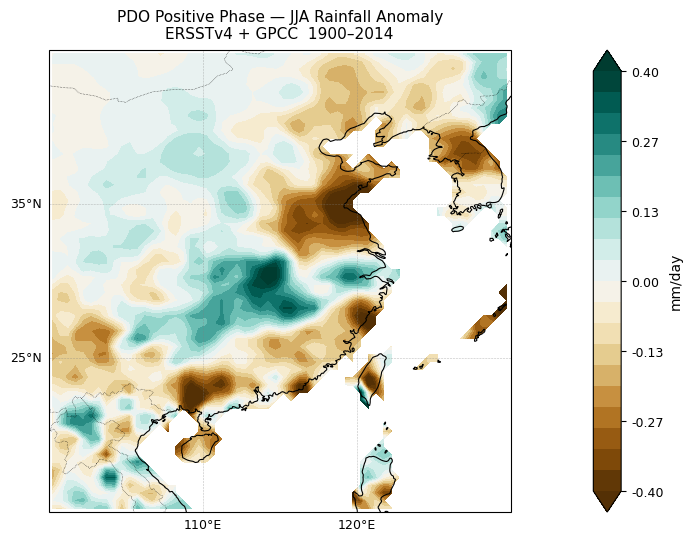

**图 A02　GPCC 正 PDO 位相降水异常。1900—2014 年；Task 1–2 为 r10i1p1f1。 降水单位 mm/day；MIROC6 原图保留了海域，不能与 ACCESS 陆地掩膜图直接比较面积统计。 数据来源：M：MIROC6 notebook 与硬盘输出。

## 图 A03　GPCC 负 PDO 位相降水异常

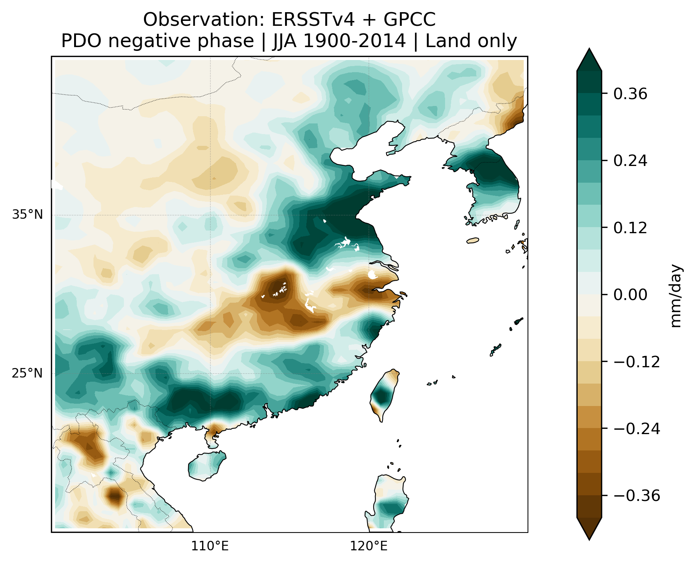

**图 A03　GPCC 负 PDO 位相降水异常。1900—2014 年；Task 1–2 为 r10i1p1f1。 降水单位 mm/day；MIROC6 原图保留了海域，不能与 ACCESS 陆地掩膜图直接比较面积统计。 数据来源：M：MIROC6 notebook 与硬盘输出。

## 图 A04　GPCC 正减负位相降水合成差

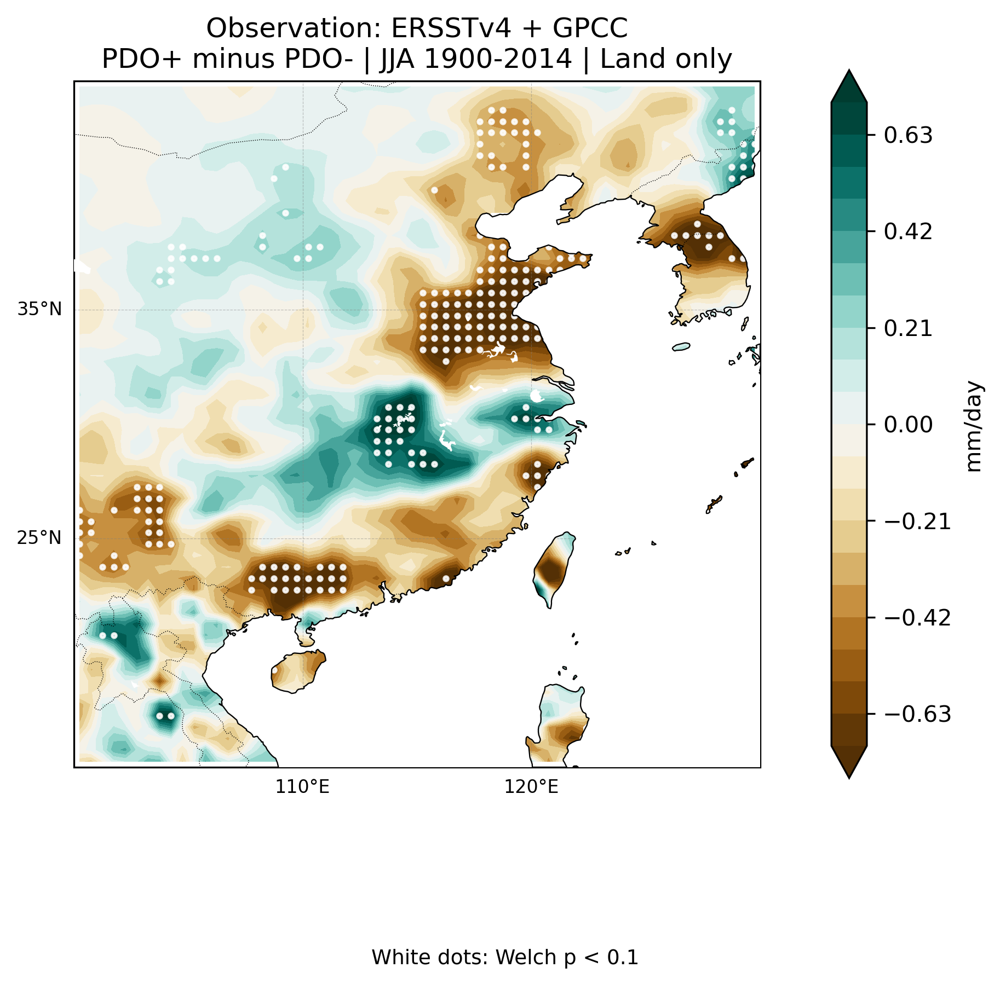

**图 A04　GPCC 正减负位相降水合成差。1900—2014 年；Task 1–2 为 r10i1p1f1。 降水单位 mm/day；MIROC6 原图保留了海域，不能与 ACCESS 陆地掩膜图直接比较面积统计。 数据来源：M：MIROC6 notebook 与硬盘输出。

## 图 A05　GPCC 位相降水三联图

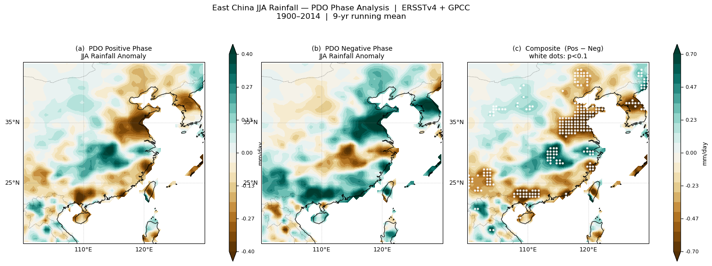

**图 A05　GPCC 位相降水三联图。1900—2014 年；Task 1–2 为 r10i1p1f1。 降水单位 mm/day；MIROC6 原图保留了海域，不能与 ACCESS 陆地掩膜图直接比较面积统计。 数据来源：M：MIROC6 notebook 与硬盘输出。

## 图 A06　MIROC6 r10 正位相降水异常

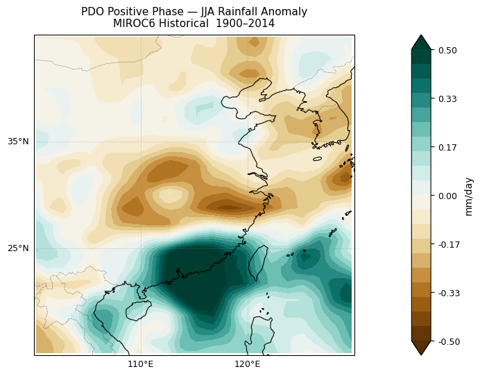

**图 A06　MIROC6 r10 正位相降水异常。1900—2014 年；Task 1–2 为 r10i1p1f1。 降水单位 mm/day；MIROC6 原图保留了海域，不能与 ACCESS 陆地掩膜图直接比较面积统计。 数据来源：M：MIROC6 notebook 与硬盘输出。

## 图 A07　MIROC6 r10 负位相降水异常

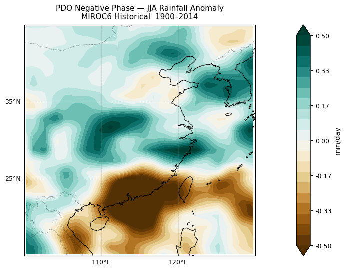

**图 A07　MIROC6 r10 负位相降水异常。1900—2014 年；Task 1–2 为 r10i1p1f1。 降水单位 mm/day；MIROC6 原图保留了海域，不能与 ACCESS 陆地掩膜图直接比较面积统计。 数据来源：M：MIROC6 notebook 与硬盘输出。

## 图 A08　MIROC6 r10 正减负位相降水合成差

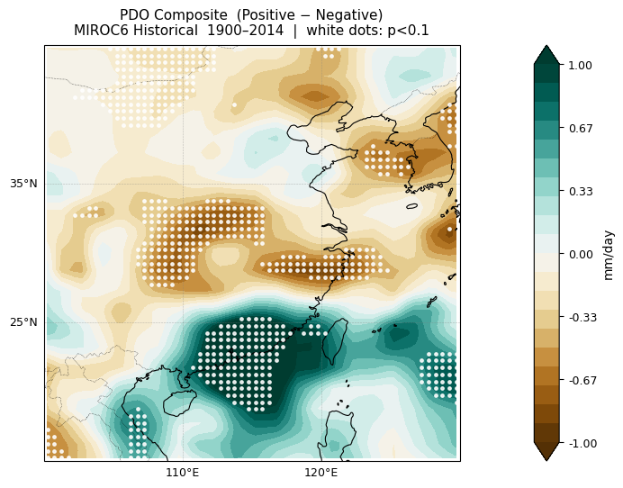

**图 A08　MIROC6 r10 正减负位相降水合成差。1900—2014 年；Task 1–2 为 r10i1p1f1。 降水单位 mm/day；MIROC6 原图保留了海域，不能与 ACCESS 陆地掩膜图直接比较面积统计。 数据来源：M：MIROC6 notebook 与硬盘输出。

## 图 A09　MIROC6 r10 位相降水三联图

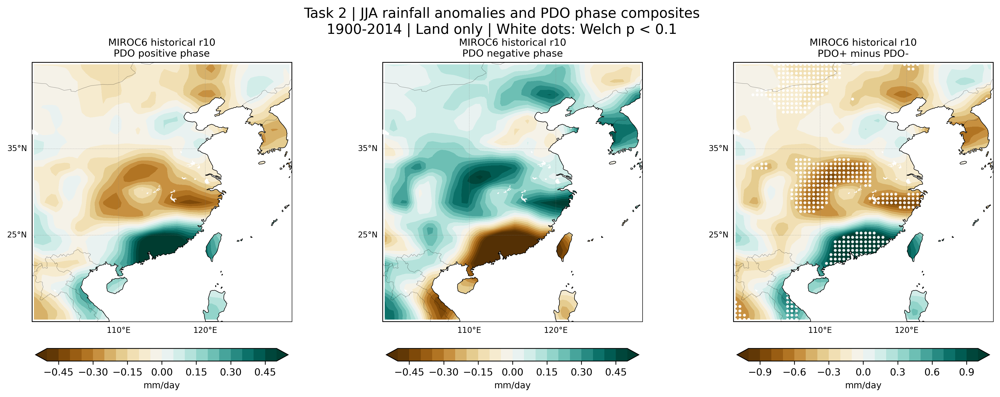

**图 A09　MIROC6 r10 位相降水三联图。1900—2014 年；Task 1–2 为 r10i1p1f1。 降水单位 mm/day；MIROC6 原图保留了海域，不能与 ACCESS 陆地掩膜图直接比较面积统计。 数据来源：M：MIROC6 notebook 与硬盘输出。

## 图 A10　观测与 MIROC6 r10 的 PDO 平滑序列

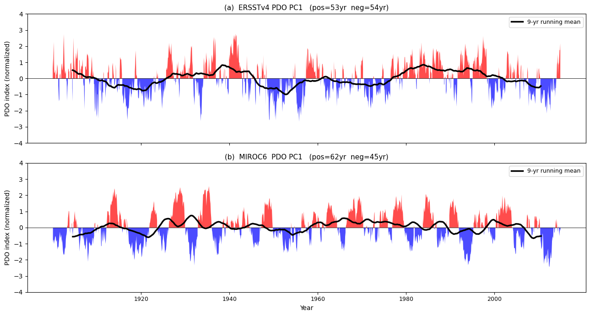

**图 A10　观测与 MIROC6 r10 的 PDO 平滑序列。1900—2014 年；Task 1–2 为 r10i1p1f1。  数据来源：M：MIROC6 notebook 与硬盘输出。

## 图 A11　MIROC6 十成员历史 PDO 时间序列

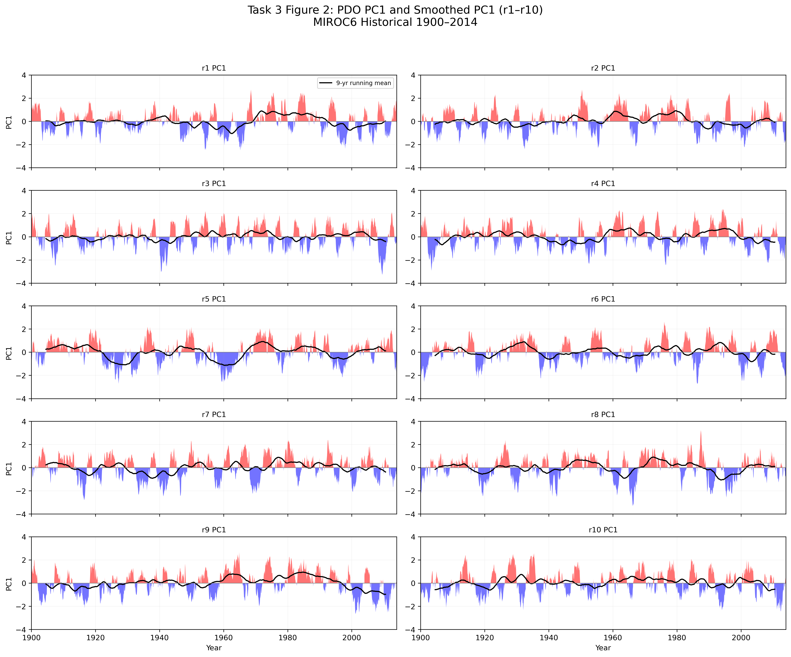

**图 A11　MIROC6 十成员历史 PDO 时间序列。1900—2014 年；r1–r10。  数据来源：M：MIROC6 notebook 与硬盘输出。

## 图 A12　MIROC6 正、负位相降水的成员方差

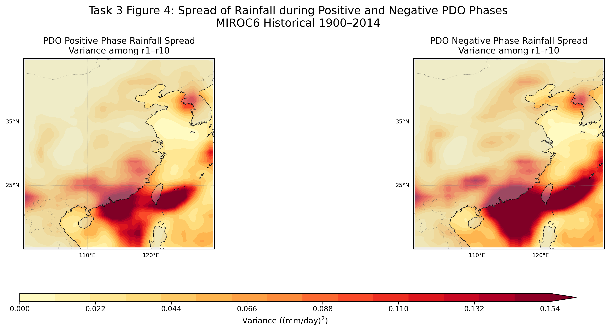

**图 A12　MIROC6 正、负位相降水的成员方差。1900—2014 年；r1–r10。 Spread 是成员间样本方差，不是成员平均降水图。 数据来源：M：MIROC6 notebook 与硬盘输出。

## 图 A13　MIROC6 四情景三成员未来 PDO 空间型

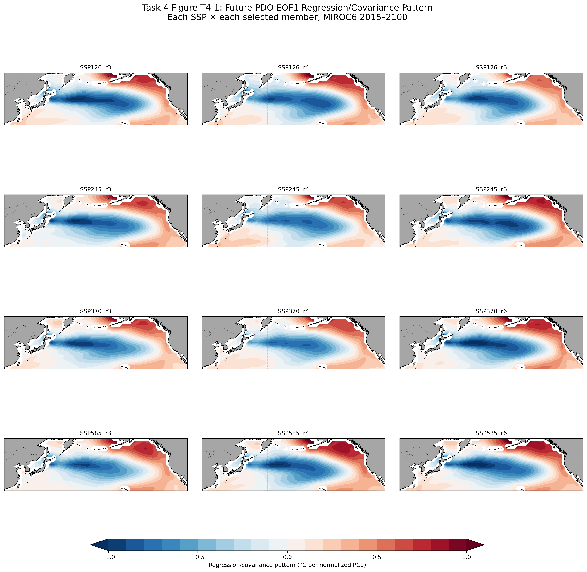

**图 A13　MIROC6 四情景三成员未来 PDO 空间型。2015—2100 年；SSP126、SSP245、SSP370、SSP585；仅 r3、r4、r6。 空间型为 SST 对标准化 PC1 的回归型，不能把色标当成无量纲特征向量。 数据来源：M：MIROC6 notebook 与硬盘输出。

## 图 A14　MIROC6 四情景三成员未来 PC1

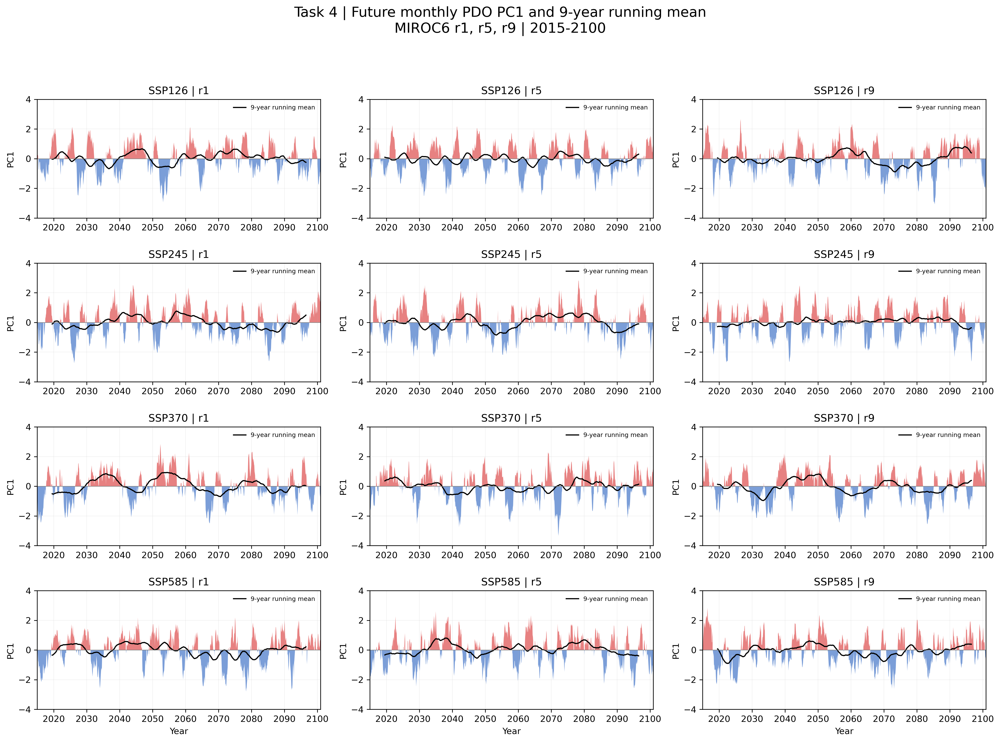

**图 A14　MIROC6 四情景三成员未来 PC1。2015—2100 年；SSP126、SSP245、SSP370、SSP585；仅 r3、r4、r6。  数据来源：M：MIROC6 notebook 与硬盘输出。

## 图 A15　MIROC6 四情景三成员正位相降水异常

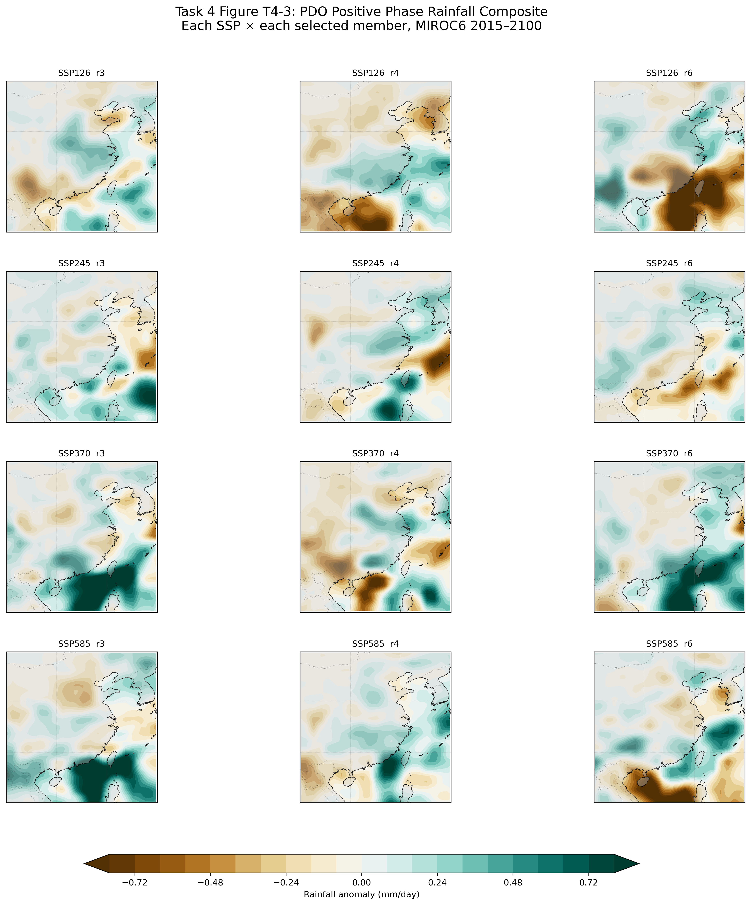

**图 A15　MIROC6 四情景三成员正位相降水异常。2015—2100 年；SSP126、SSP245、SSP370、SSP585；仅 r3、r4、r6。 降水单位 mm/day；MIROC6 原图保留了海域，不能与 ACCESS 陆地掩膜图直接比较面积统计。 数据来源：M：MIROC6 notebook 与硬盘输出。

## 图 A16　MIROC6 四情景三成员负位相降水异常

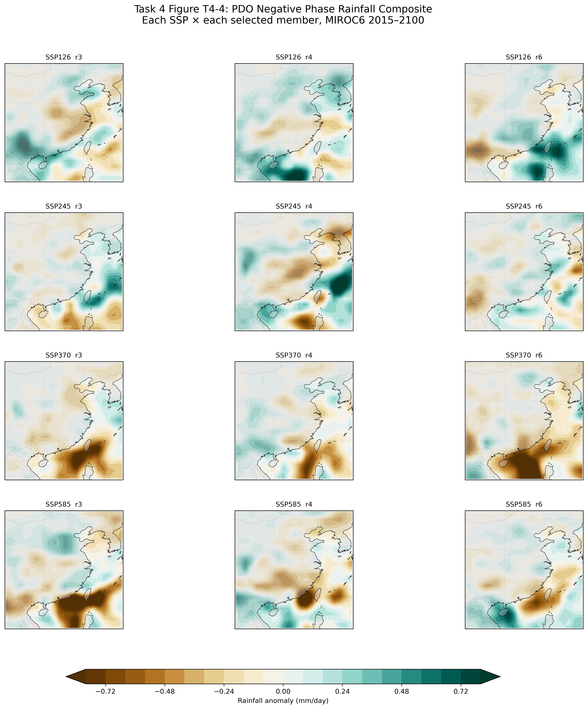

**图 A16　MIROC6 四情景三成员负位相降水异常。2015—2100 年；SSP126、SSP245、SSP370、SSP585；仅 r3、r4、r6。 降水单位 mm/day；MIROC6 原图保留了海域，不能与 ACCESS 陆地掩膜图直接比较面积统计。 数据来源：M：MIROC6 notebook 与硬盘输出。

## 图 A17　ACCESS-CM2 r1 历史 PDO 空间型与 PC1

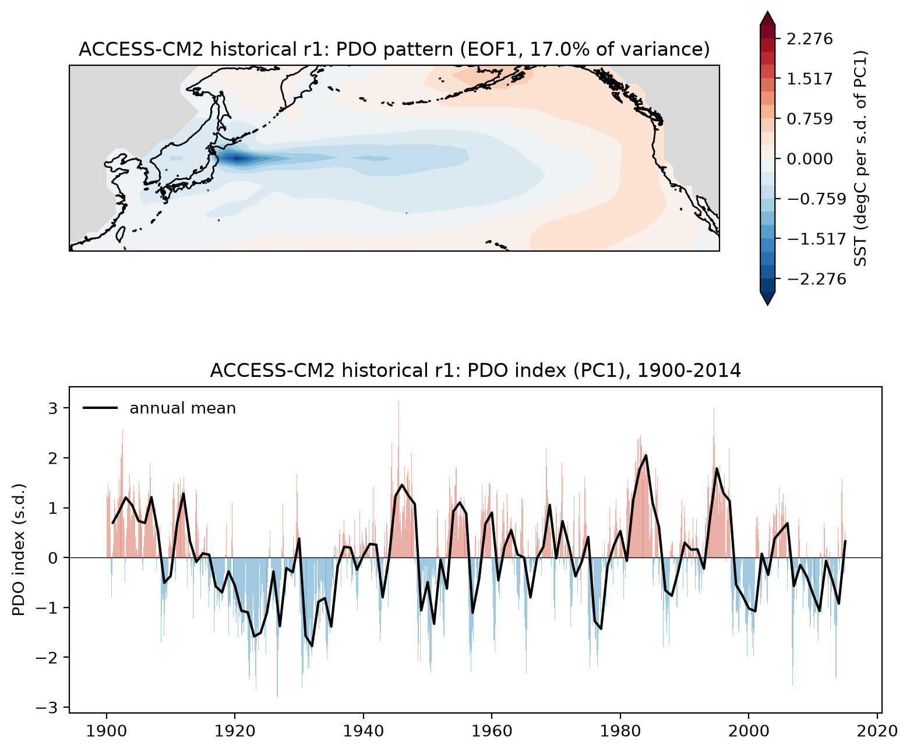

**图 A17　ACCESS-CM2 r1 历史 PDO 空间型与 PC1。1900—2014 年；历史 r1–r5。  数据来源：A：ACCESS 海温/降水五成员资料，现行 EOF1/线性去趋势流程。

## 图 A18　ACCESS-CM2 r2 历史 PDO 空间型与 PC1

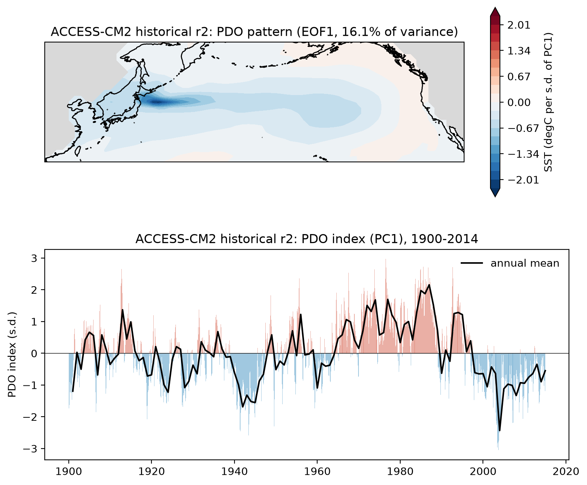

**图 A18　ACCESS-CM2 r2 历史 PDO 空间型与 PC1。1900—2014 年；历史 r1–r5。  数据来源：A：ACCESS 海温/降水五成员资料，现行 EOF1/线性去趋势流程。

## 图 A19　ACCESS-CM2 r3 历史 PDO 空间型与 PC1

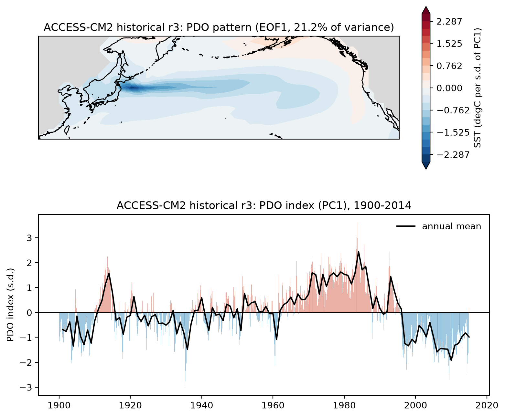

**图 A19　ACCESS-CM2 r3 历史 PDO 空间型与 PC1。1900—2014 年；历史 r1–r5。  数据来源：A：ACCESS 海温/降水五成员资料，现行 EOF1/线性去趋势流程。

## 图 A20　ACCESS-CM2 r4 历史 PDO 空间型与 PC1

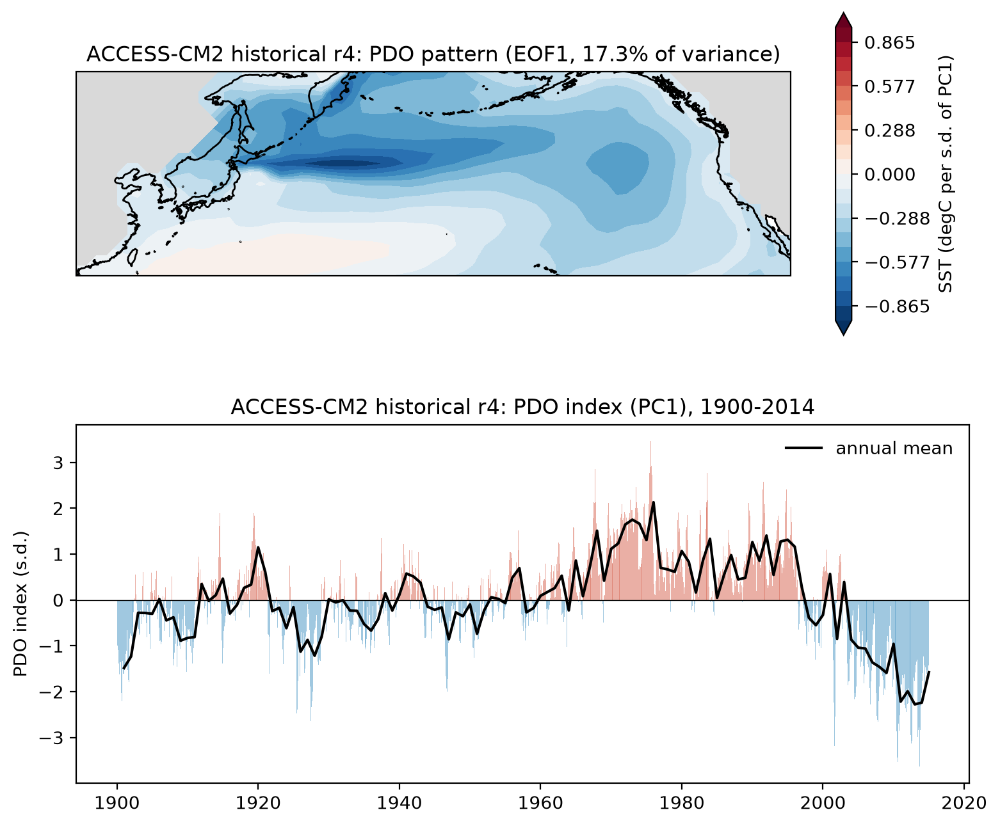

**图 A20　ACCESS-CM2 r4 历史 PDO 空间型与 PC1。1900—2014 年；历史 r1–r5。  数据来源：A：ACCESS 海温/降水五成员资料，现行 EOF1/线性去趋势流程。

## 图 A21　ACCESS-CM2 r5 历史 PDO 空间型与 PC1

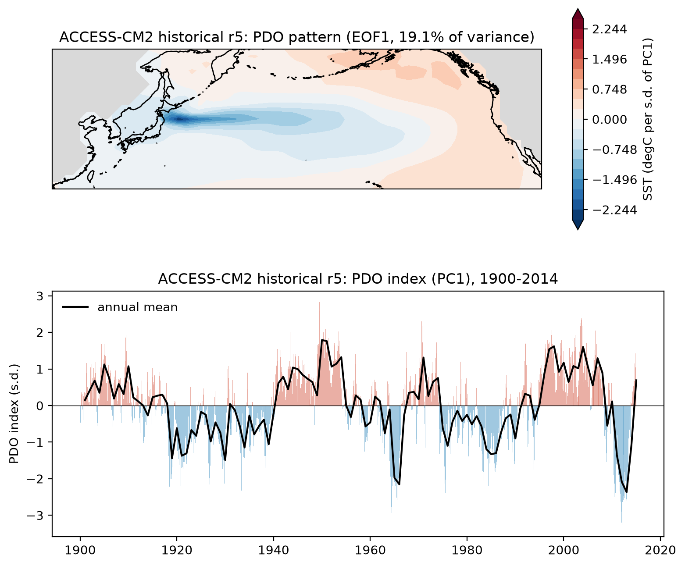

**图 A21　ACCESS-CM2 r5 历史 PDO 空间型与 PC1。1900—2014 年；历史 r1–r5。  数据来源：A：ACCESS 海温/降水五成员资料，现行 EOF1/线性去趋势流程。

## 图 A22　ERSSTv4 PDO 空间型与 PC1

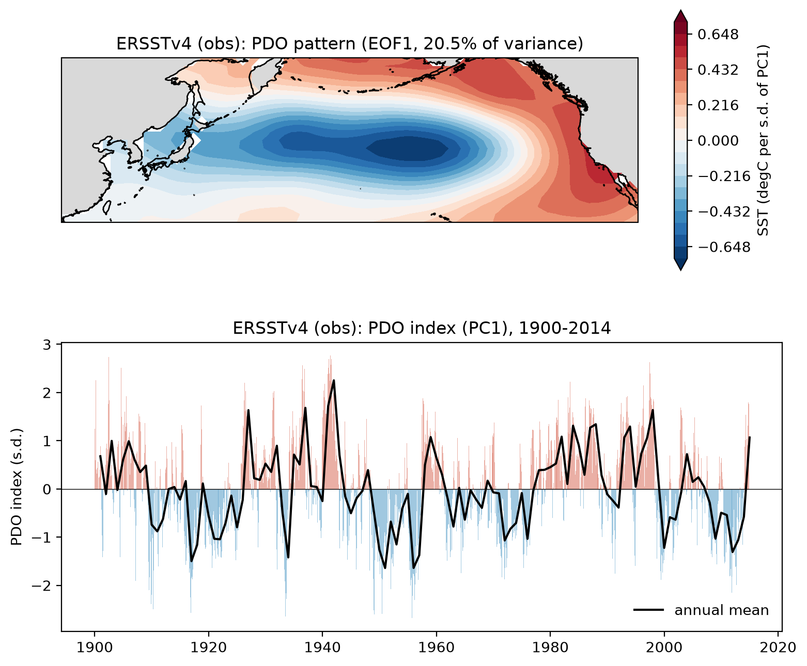

**图 A22　ERSSTv4 PDO 空间型与 PC1。1900—2014 年；历史 r1–r5。  数据来源：A：ACCESS 海温/降水五成员资料，现行 EOF1/线性去趋势流程。

## 图 A23　ACCESS 流程中的 GPCC 位相降水三联图

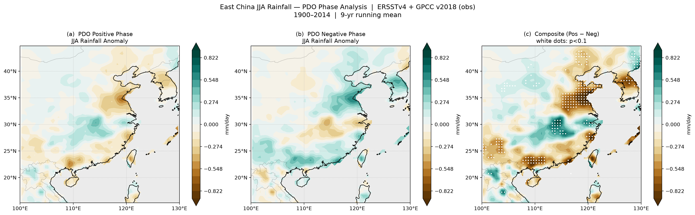

**图 A23　ACCESS 流程中的 GPCC 位相降水三联图。1900—2014 年；历史 r1–r5。 仅陆地；降水异常/合成差为 mm/day，成员方差为 (mm/day)²。白点若存在，表示未校正自相关和多重比较的逐格点 p<0.1。 数据来源：A：ACCESS 海温/降水五成员资料，现行 EOF1/线性去趋势流程。

## 图 A24　ACCESS-CM2 与观测 PDO 时间序列

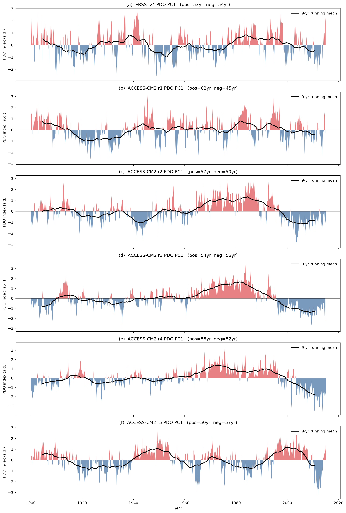

**图 A24　ACCESS-CM2 与观测 PDO 时间序列。1900—2014 年；历史 r1–r5。  数据来源：A：ACCESS 海温/降水五成员资料，现行 EOF1/线性去趋势流程。

## 图 A25–A29　ACCESS-CM2 R1–R5 历史位相降水总图

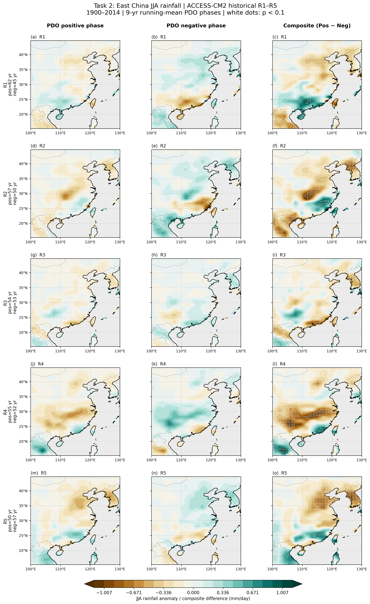

**图 A25–A29**　原五张逐成员三联图合并为一张 5 行 × 3 列图。行依次为 R1–R5；列依次为 PDO 正位相、负位相降水异常及正减负合成差。1900—2014 年，九年滑动平均 PDO 的 JJA 均值判定位相。15 个子图共用色标，单位 mm/day；保留陆地掩膜和逐格点 p<0.1 白点，显著性未校正自相关及多重比较。数据来源：A：ACCESS 海温/降水五成员资料，现行 EOF1/线性去趋势流程。

## 图 A30　ACCESS-CM2 历史 PDO 空间型及成员方差

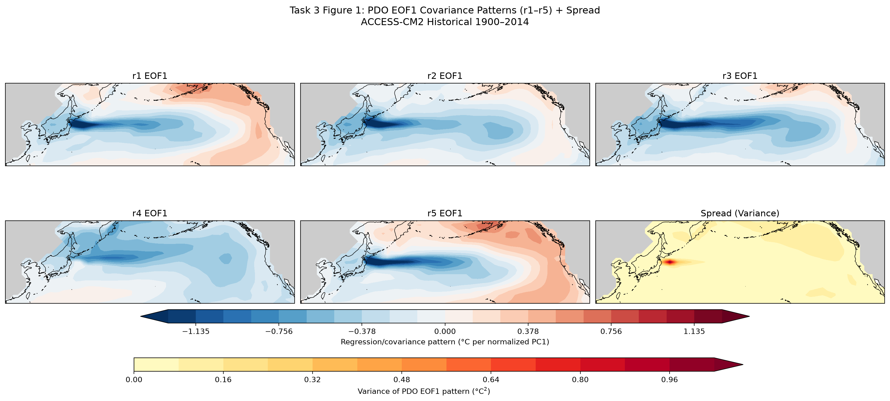

**图 A30　ACCESS-CM2 历史 PDO 空间型及成员方差。1900—2014 年；历史 r1–r5。  数据来源：A：ACCESS 海温/降水五成员资料，现行 EOF1/线性去趋势流程。

## 图 A31　ACCESS-CM2 历史 PC1 与九年平滑序列

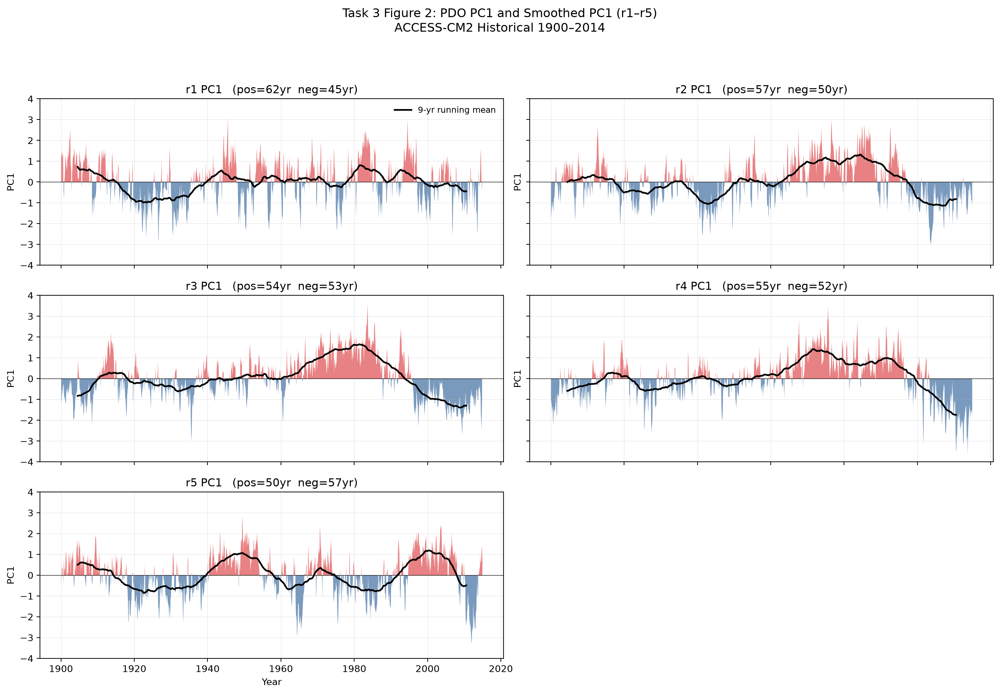

**图 A31　ACCESS-CM2 历史 PC1 与九年平滑序列。1900—2014 年；历史 r1–r5。  数据来源：A：ACCESS 海温/降水五成员资料，现行 EOF1/线性去趋势流程。

## 图 A32　ACCESS-CM2 正、负位相降水的成员方差

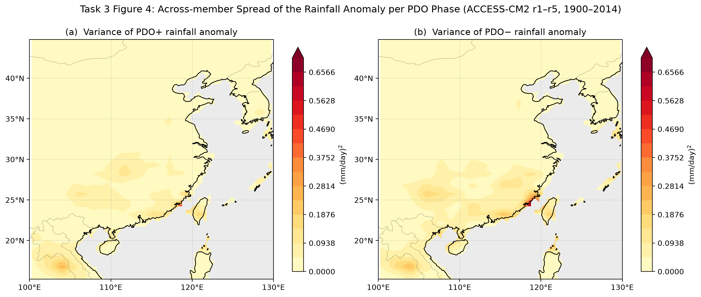

**图 A32　ACCESS-CM2 正、负位相降水的成员方差。1900—2014 年；历史 r1–r5。 仅陆地；降水异常/合成差为 mm/day，成员方差为 (mm/day)²。白点若存在，表示未校正自相关和多重比较的逐格点 p<0.1。 数据来源：A：ACCESS 海温/降水五成员资料，现行 EOF1/线性去趋势流程。

## 图 A33　ACCESS-CM2 两情景五成员未来 PC1

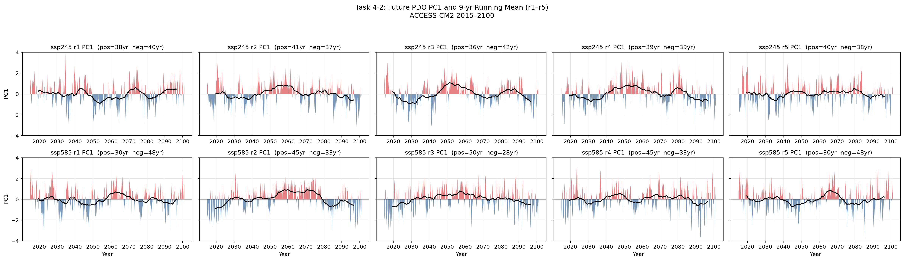

**图 A33　ACCESS-CM2 两情景五成员未来 PC1。2015—2100 年；SSP245、SSP585，r1–r5。  数据来源：A：ACCESS 海温/降水五成员资料，现行 EOF1/线性去趋势流程。

## 图 A34　ACCESS-CM2 两情景五成员正位相降水异常

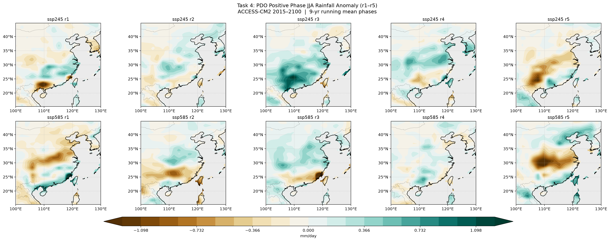

**图 A34　ACCESS-CM2 两情景五成员正位相降水异常。2015—2100 年；SSP245、SSP585，r1–r5。 仅陆地；降水异常/合成差为 mm/day，成员方差为 (mm/day)²。白点若存在，表示未校正自相关和多重比较的逐格点 p<0.1。 数据来源：A：ACCESS 海温/降水五成员资料，现行 EOF1/线性去趋势流程。

## 图 A35　ACCESS-CM2 两情景五成员负位相降水异常

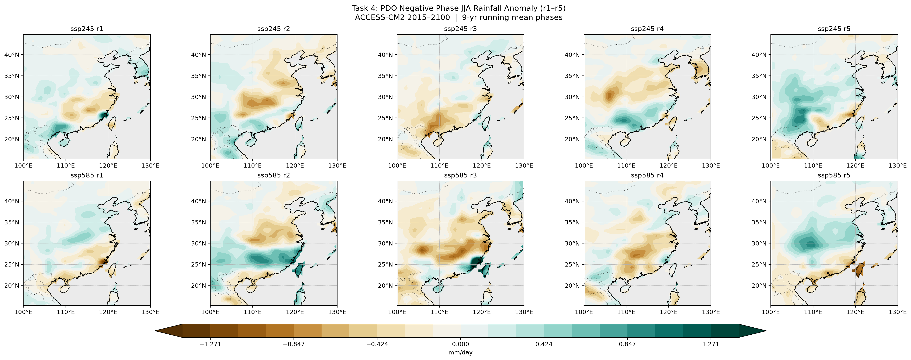

**图 A35　ACCESS-CM2 两情景五成员负位相降水异常。2015—2100 年；SSP245、SSP585，r1–r5。 仅陆地；降水异常/合成差为 mm/day，成员方差为 (mm/day)²。白点若存在，表示未校正自相关和多重比较的逐格点 p<0.1。 数据来源：A：ACCESS 海温/降水五成员资料，现行 EOF1/线性去趋势流程。

## 图 A36　PDO 主谱峰周期与峰带方差汇总

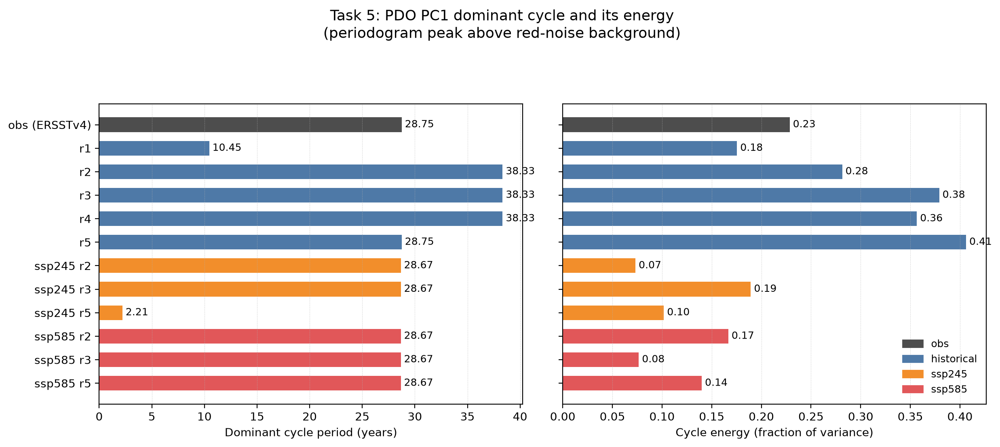

**图 A36　PDO 主谱峰周期与峰带方差汇总。历史 1900—2014 年；未来 2015—2100 年。 使用未经九年平滑的标准化月度 PC1。历史包含 r1–r5，未来只包含指定的 r2、r3、r5。红噪声阈值是近似逐频点阈值，峰带随序列改变。 数据来源：A：ACCESS 海温/降水五成员资料，现行 EOF1/线性去趋势流程。

## 图 A37　固定 5870 gpm 副高位相轮廓

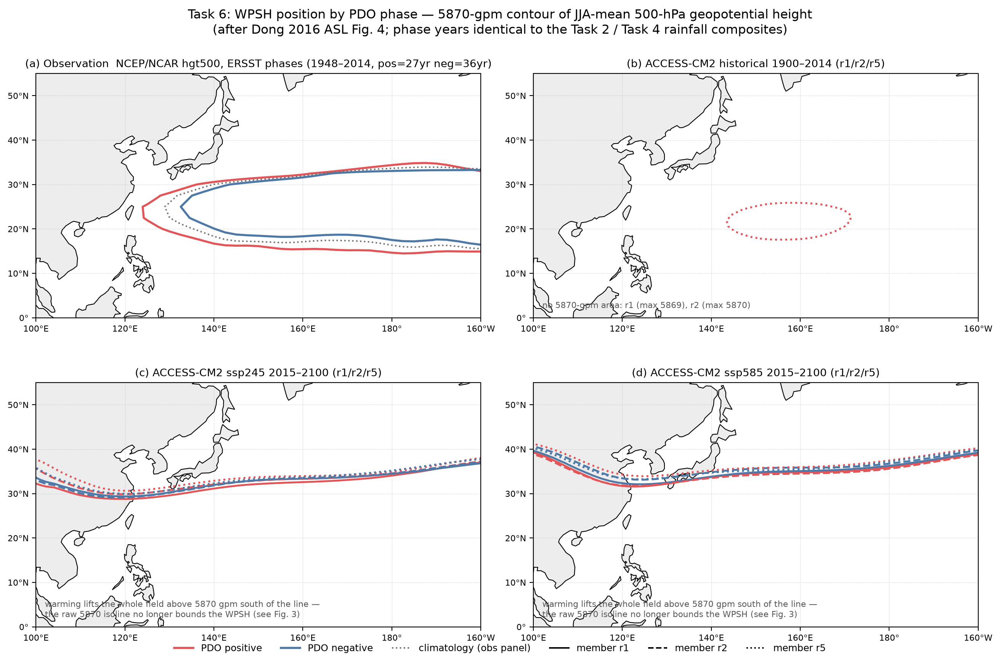

**图 A37　固定 5870 gpm 副高位相轮廓。NCEP 1948—2014 年；ACCESS 历史 1900—2014 年，未来 2015—2100 年；r1、r2、r5。 固定 5870 gpm；缺线和未来轮廓退化保留原样。 数据来源：Z-current：现行 500 hPa 流程。

## 图 A38　等面积阈值副高逐成员位相轮廓

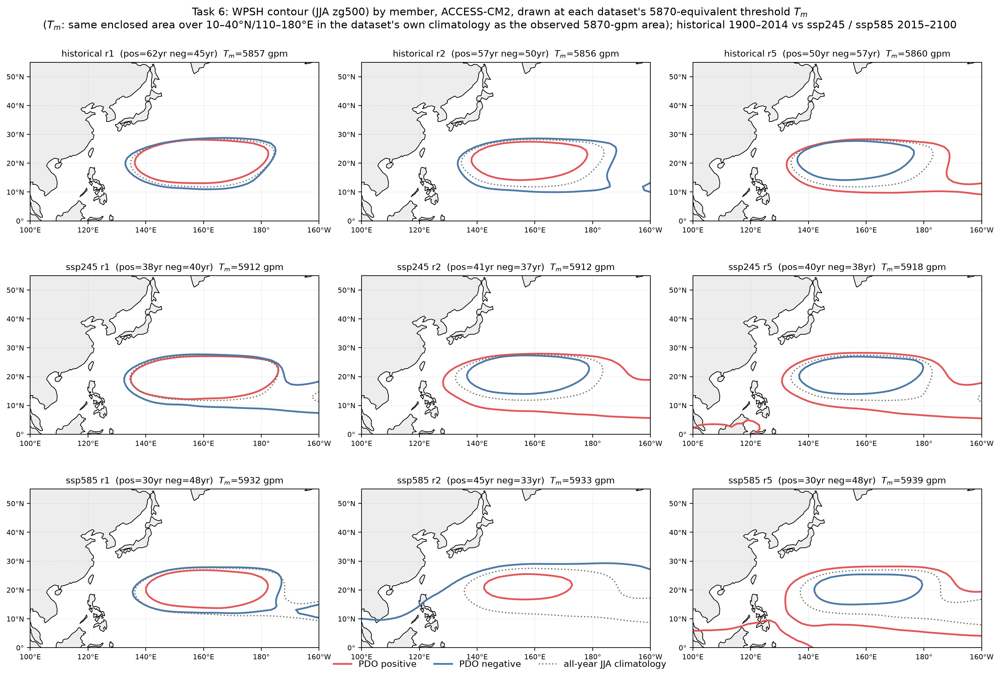

**图 A38　等面积阈值副高逐成员位相轮廓。NCEP 1948—2014 年；ACCESS 历史 1900—2014 年，未来 2015—2100 年；r1、r2、r5。 模式使用各数据集自身气候态的等面积阈值 Tm；观测仍为 5870 gpm。此方法不是加一个常数的高度偏差订正。文件名含 5870，但模式面板实际使用 Tm，以图内阈值及代码为准。 数据来源：Z-current：现行 500 hPa 流程。

## 图 A39　早期固定阈值：1948—2014 年共同窗口比较

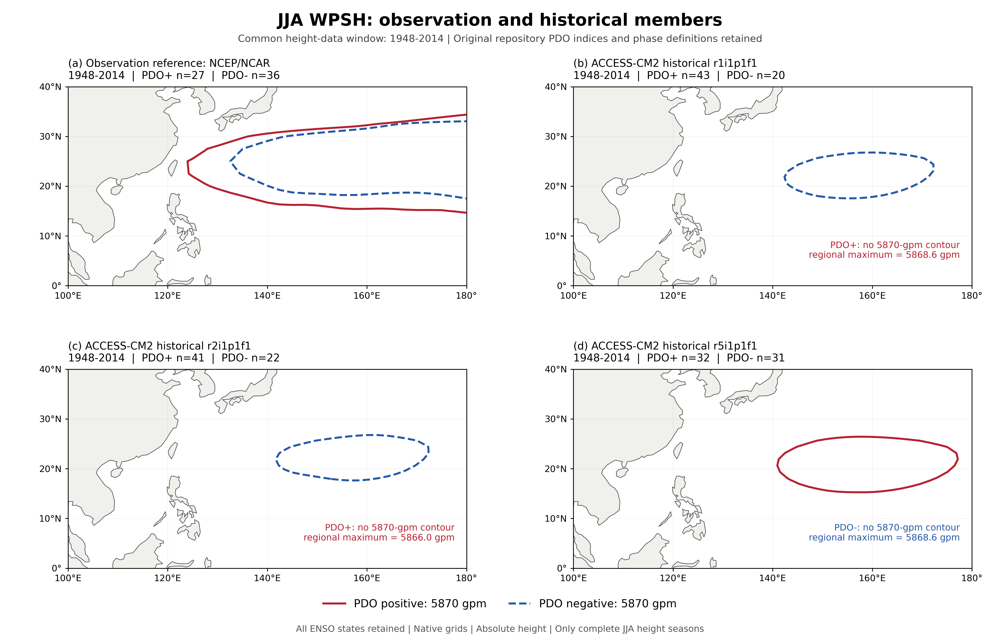

**图 A39　早期固定阈值：1948—2014 年共同窗口比较。观测及历史模式均限制高度资料为 1948—2014 年；PDO 分类仍沿用完整历史指数。 与硬盘 task6_wpsh_outputs 的同名 PNG 校验码相同。此组用于固定阈值/绘图版本对照，不作为独立模式样本。 数据来源：Z-full：9 月 12 日开始下载的全层原始 zg 文件；早期本地 Task 6。

## 图 A40　早期固定阈值：观测与历史正负位相分栏

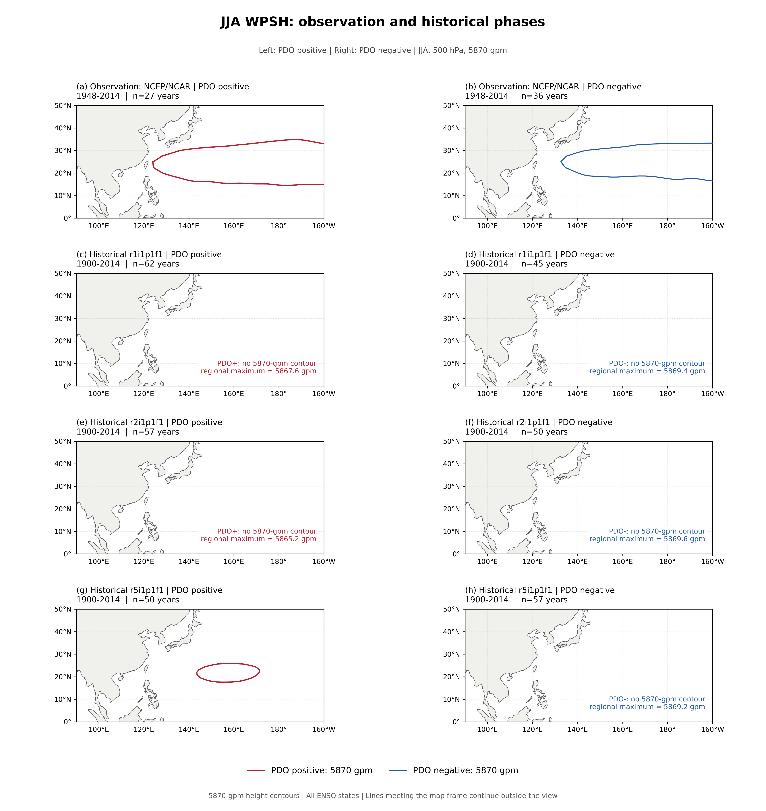

**图 A40　早期固定阈值：观测与历史正负位相分栏。r1、r2、r5；固定 5870 gpm。历史 1900—2014 年，未来 2015—2100 年；观测 1948—2014 年。 与硬盘 task6_wpsh_outputs 的同名 PNG 校验码相同。此组用于固定阈值/绘图版本对照，不作为独立模式样本。 数据来源：Z-full：9 月 12 日开始下载的全层原始 zg 文件；早期本地 Task 6。

## 图 A41　早期固定阈值：观测、历史与未来总览

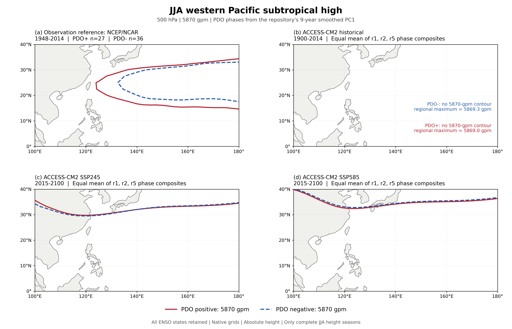

**图 A41　早期固定阈值：观测、历史与未来总览。r1、r2、r5；固定 5870 gpm。历史 1900—2014 年，未来 2015—2100 年；观测 1948—2014 年。 与硬盘 task6_wpsh_outputs 的同名 PNG 校验码相同。此组用于固定阈值/绘图版本对照，不作为独立模式样本。模式面板是三成员位势高度合成场平均，不是降水成员平均。 数据来源：Z-full：9 月 12 日开始下载的全层原始 zg 文件；早期本地 Task 6。

## 图 A42　早期固定阈值：三成员逐一对照

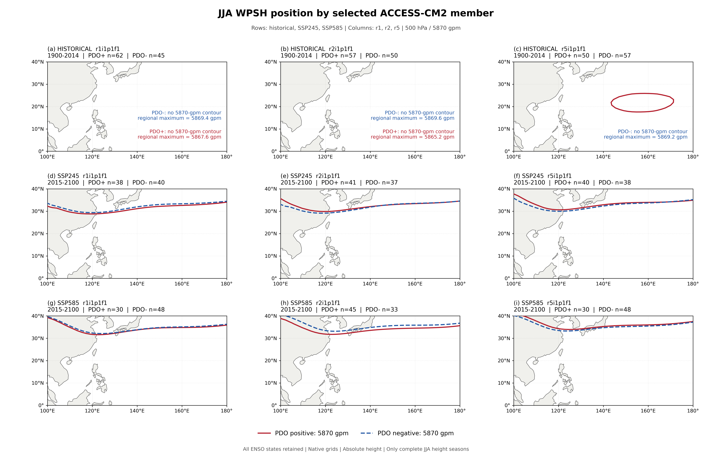

**图 A42　早期固定阈值：三成员逐一对照。r1、r2、r5；固定 5870 gpm。历史 1900—2014 年，未来 2015—2100 年；观测 1948—2014 年。 与硬盘 task6_wpsh_outputs 的同名 PNG 校验码相同。此组用于固定阈值/绘图版本对照，不作为独立模式样本。 数据来源：Z-full：9 月 12 日开始下载的全层原始 zg 文件；早期本地 Task 6。

## 图 A43　早期固定阈值：SSP245 正负位相分栏

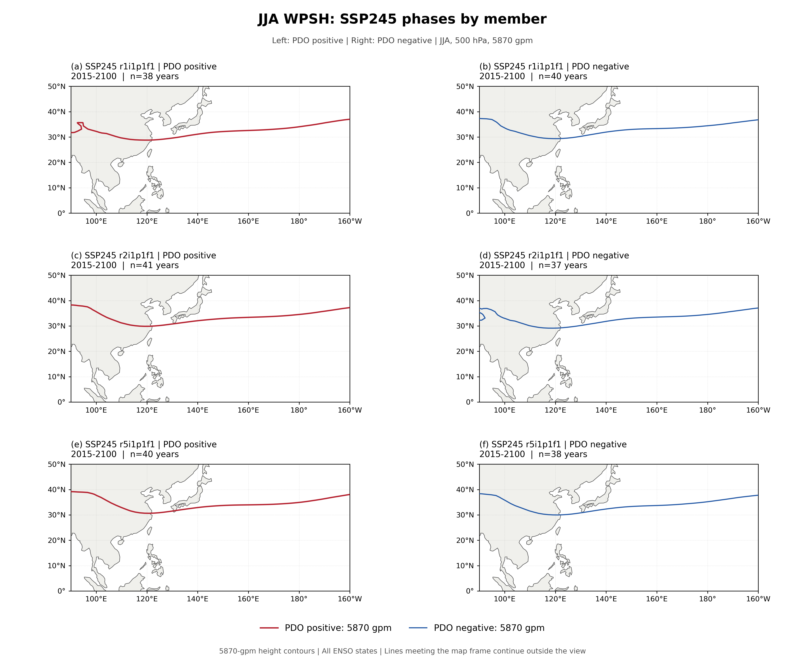

**图 A43　早期固定阈值：SSP245 正负位相分栏。r1、r2、r5；固定 5870 gpm。历史 1900—2014 年，未来 2015—2100 年；观测 1948—2014 年。 与硬盘 task6_wpsh_outputs 的同名 PNG 校验码相同。此组用于固定阈值/绘图版本对照，不作为独立模式样本。 数据来源：Z-full：9 月 12 日开始下载的全层原始 zg 文件；早期本地 Task 6。

## 图 A44　早期固定阈值：SSP585 正负位相分栏

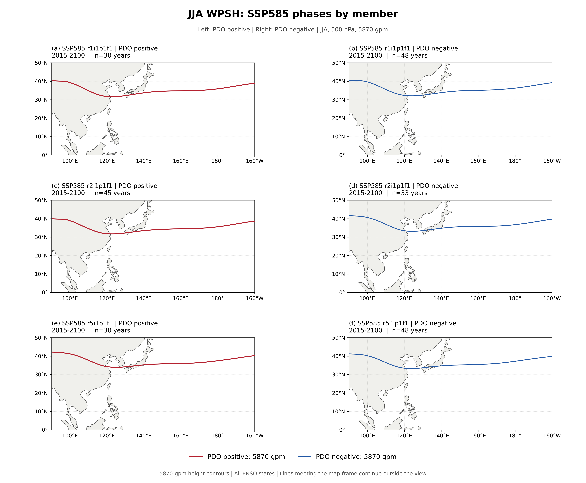

**图 A44　早期固定阈值：SSP585 正负位相分栏。r1、r2、r5；固定 5870 gpm。历史 1900—2014 年，未来 2015—2100 年；观测 1948—2014 年。 与硬盘 task6_wpsh_outputs 的同名 PNG 校验码相同。此组用于固定阈值/绘图版本对照，不作为独立模式样本。 数据来源：Z-full：9 月 12 日开始下载的全层原始 zg 文件；早期本地 Task 6。

## 图 A45　ACCESS-CM2 流函数副高指数六组总览

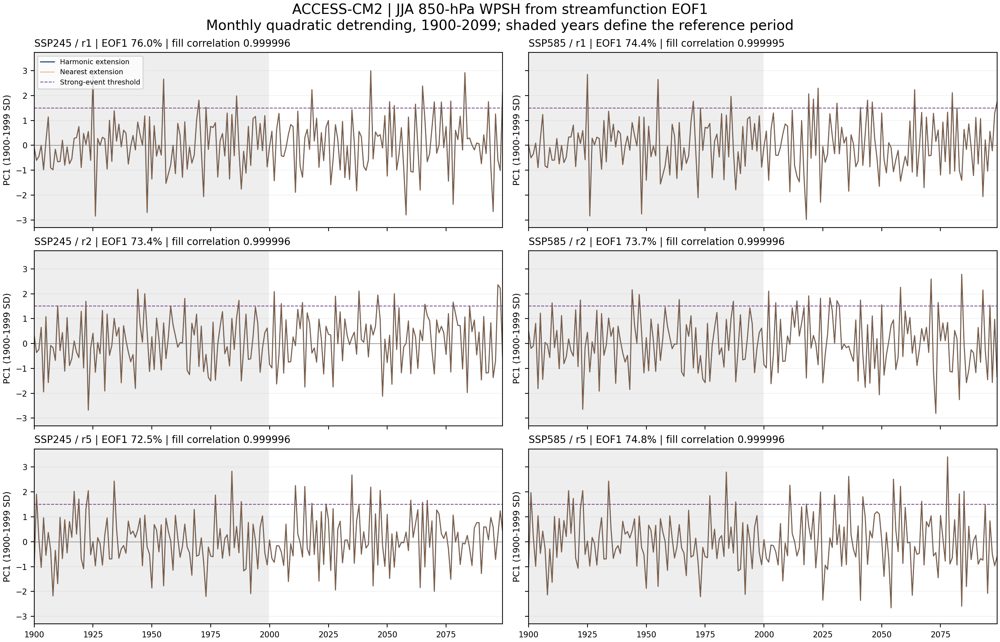

**图 A45　ACCESS-CM2 流函数副高指数六组总览。ACCESS r1、r2、r5，SSP245/SSP585；1900—2100 年，历史标准化基准 1900—2014 年。 此指数衡量副高环流年际变率，与 Task 6 的 500 hPa 位相合成诊断不同。强事件为历史基准标准化指数超过 1.5。 数据来源：W：850 hPa 风场与流函数 EOF 分析。

## 图 A46　ACCESS-CM2 SSP245 r1 副高流函数 EOF 与指数

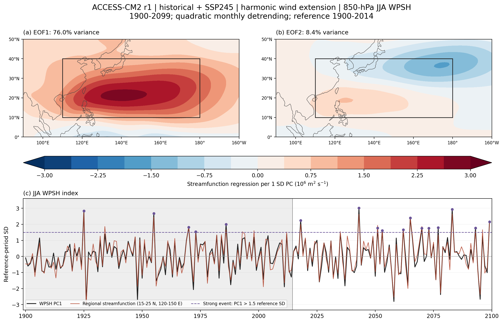

**图 A46　ACCESS-CM2 SSP245 r1 副高流函数 EOF 与指数。ACCESS r1、r2、r5，SSP245/SSP585；1900—2100 年，历史标准化基准 1900—2014 年。 此指数衡量副高环流年际变率，与 Task 6 的 500 hPa 位相合成诊断不同。强事件为历史基准标准化指数超过 1.5。 数据来源：W：850 hPa 风场与流函数 EOF 分析。

## 图 A47　ACCESS-CM2 SSP245 r2 副高流函数 EOF 与指数

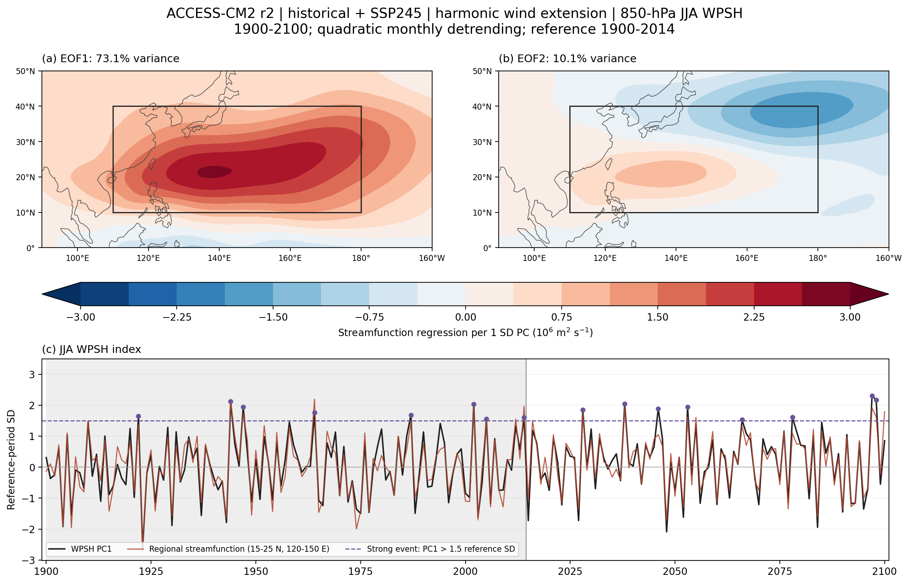

**图 A47　ACCESS-CM2 SSP245 r2 副高流函数 EOF 与指数。ACCESS r1、r2、r5，SSP245/SSP585；1900—2100 年，历史标准化基准 1900—2014 年。 此指数衡量副高环流年际变率，与 Task 6 的 500 hPa 位相合成诊断不同。强事件为历史基准标准化指数超过 1.5。 数据来源：W：850 hPa 风场与流函数 EOF 分析。

## 图 A48　ACCESS-CM2 SSP245 r5 副高流函数 EOF 与指数

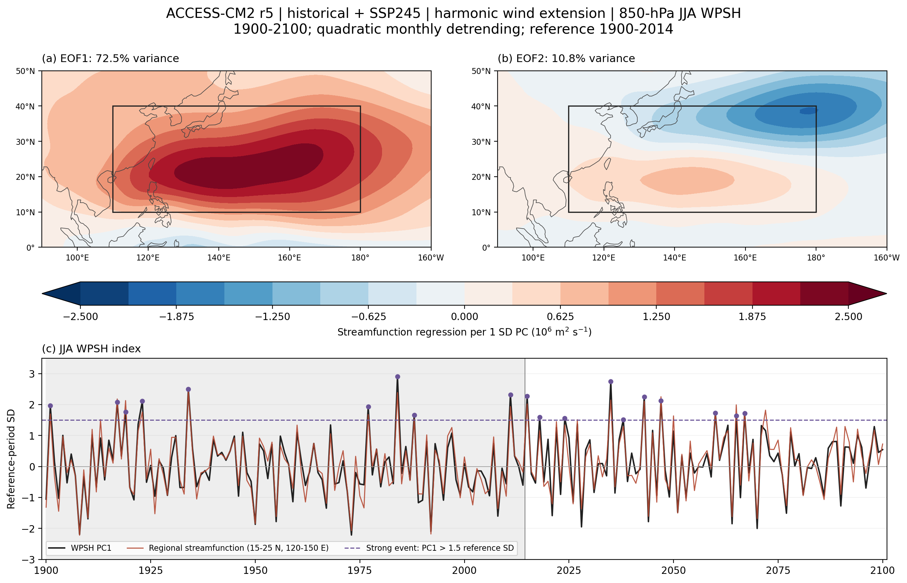

**图 A48　ACCESS-CM2 SSP245 r5 副高流函数 EOF 与指数。ACCESS r1、r2、r5，SSP245/SSP585；1900—2100 年，历史标准化基准 1900—2014 年。 此指数衡量副高环流年际变率，与 Task 6 的 500 hPa 位相合成诊断不同。强事件为历史基准标准化指数超过 1.5。 数据来源：W：850 hPa 风场与流函数 EOF 分析。

## 图 A49　ACCESS-CM2 SSP585 r1 副高流函数 EOF 与指数

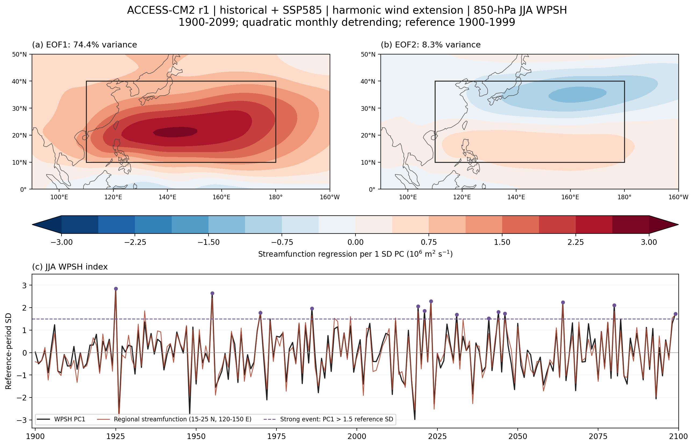

**图 A49　ACCESS-CM2 SSP585 r1 副高流函数 EOF 与指数。ACCESS r1、r2、r5，SSP245/SSP585；1900—2100 年，历史标准化基准 1900—2014 年。 此指数衡量副高环流年际变率，与 Task 6 的 500 hPa 位相合成诊断不同。强事件为历史基准标准化指数超过 1.5。 数据来源：W：850 hPa 风场与流函数 EOF 分析。

## 图 A50　ACCESS-CM2 SSP585 r2 副高流函数 EOF 与指数

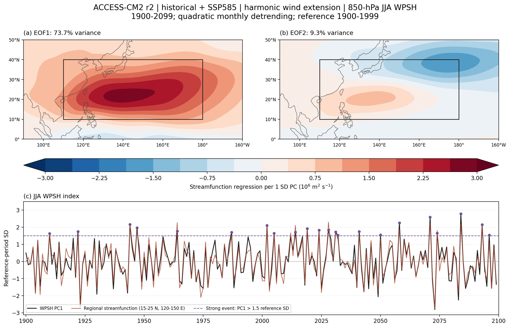

**图 A50　ACCESS-CM2 SSP585 r2 副高流函数 EOF 与指数。ACCESS r1、r2、r5，SSP245/SSP585；1900—2100 年，历史标准化基准 1900—2014 年。 此指数衡量副高环流年际变率，与 Task 6 的 500 hPa 位相合成诊断不同。强事件为历史基准标准化指数超过 1.5。 数据来源：W：850 hPa 风场与流函数 EOF 分析。

## 图 A51　ACCESS-CM2 SSP585 r5 副高流函数 EOF 与指数

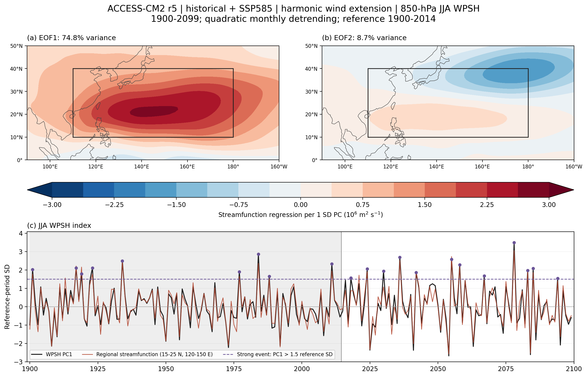

**图 A51　ACCESS-CM2 SSP585 r5 副高流函数 EOF 与指数。ACCESS r1、r2、r5，SSP245/SSP585；1900—2100 年，历史标准化基准 1900—2014 年。 此指数衡量副高环流年际变率，与 Task 6 的 500 hPa 位相合成诊断不同。强事件为历史基准标准化指数超过 1.5。 数据来源：W：850 hPa 风场与流函数 EOF 分析。

## 图 A52　NCEP/NCAR 副高流函数 EOF 与强事件

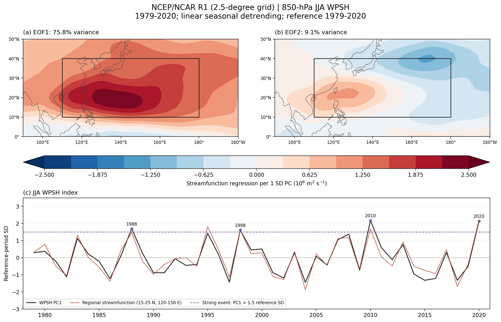

**图 A52　NCEP/NCAR 副高流函数 EOF 与强事件。NCEP/NCAR 2.5° 全球 850 hPa 月风，1979—2020 年，共 42 个夏季。 此指数衡量副高环流年际变率，与 Task 6 的 500 hPa 位相合成诊断不同。强事件为历史基准标准化指数超过 1.5。 数据来源：W：850 hPa 风场与流函数 EOF 分析。

## 图 A53　Task 5 的方法参考图

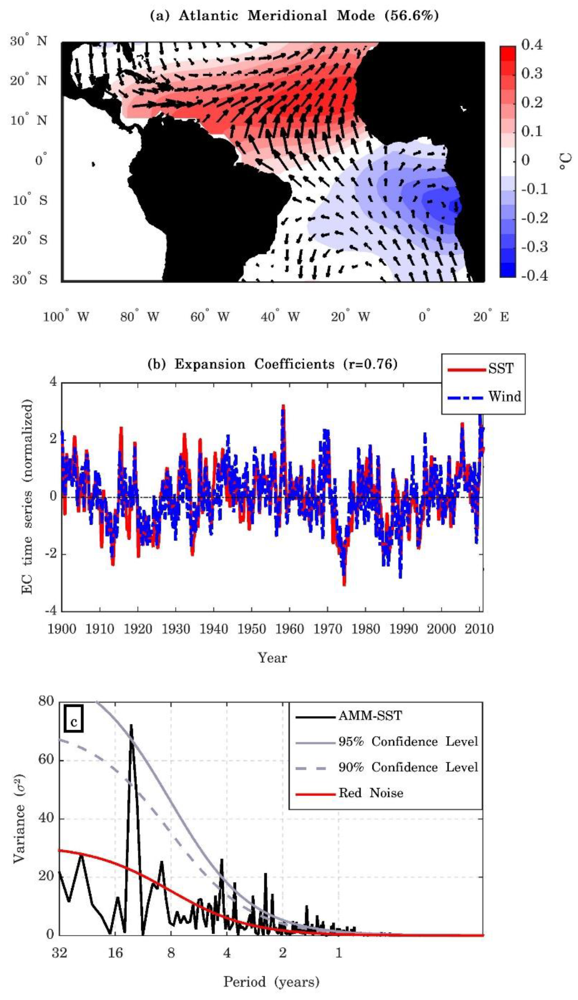

**图 A53**　用户提供的 Veiga 等（2020）Figure 1 截图，来源：[原论文](https://doi.org/10.3390/atmos11010003)，开放许可 CC BY 4.0。原图讨论大西洋经向模态（AMM），包含海温—风场耦合空间型、时间系数及相对于红噪声的功率谱。本项目只借鉴“空间结构—时间系数—谱检验”的诊断思路；并未计算这张图中的大西洋模态，也未将其周期当作 PDO 的已知周期。截图不计入本项目的 65 张研究结果图。
